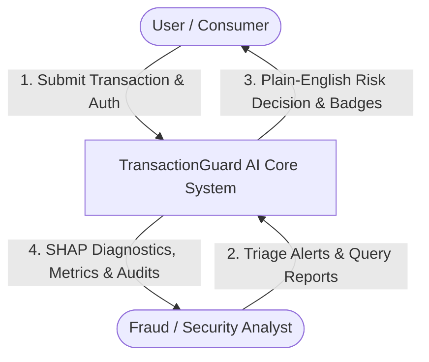
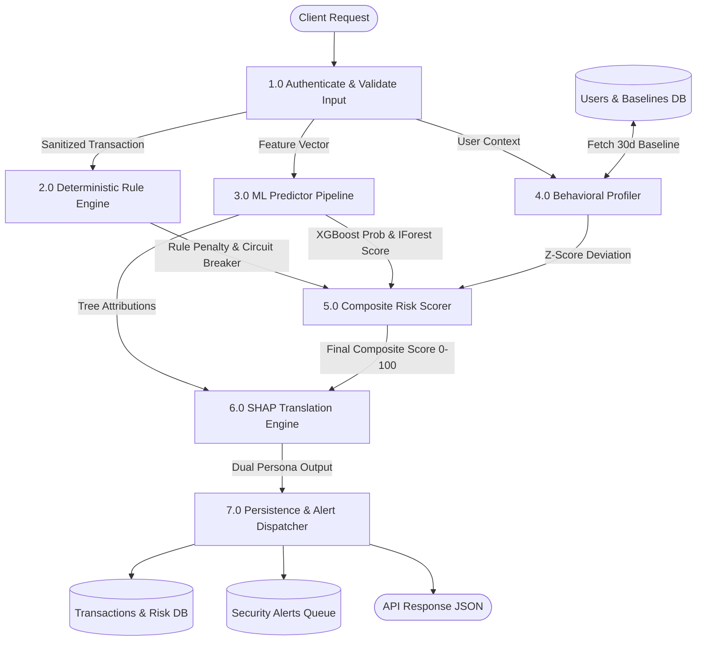
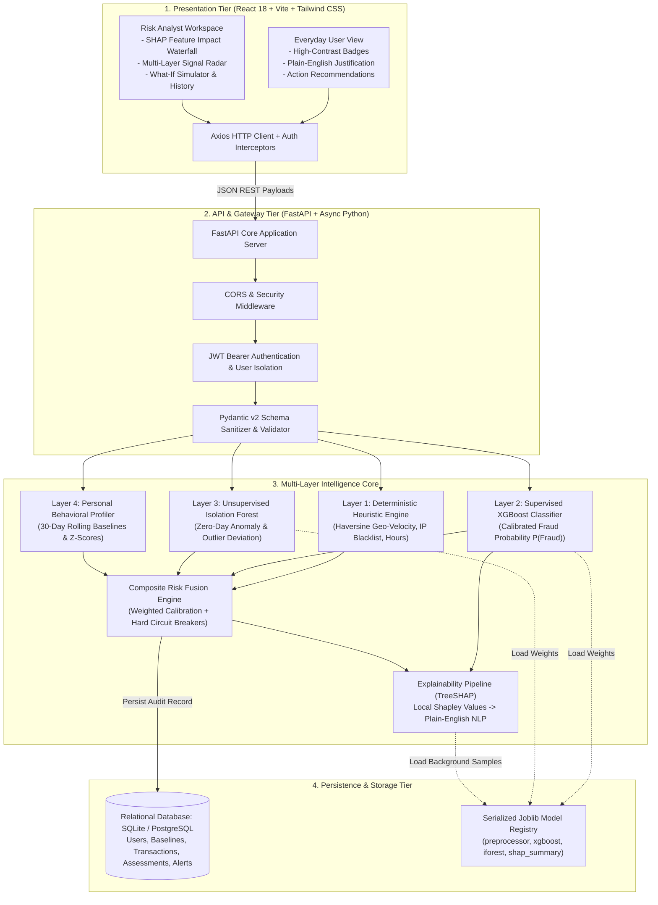
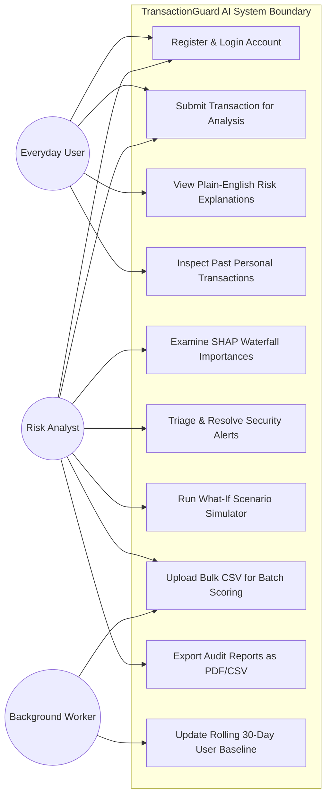
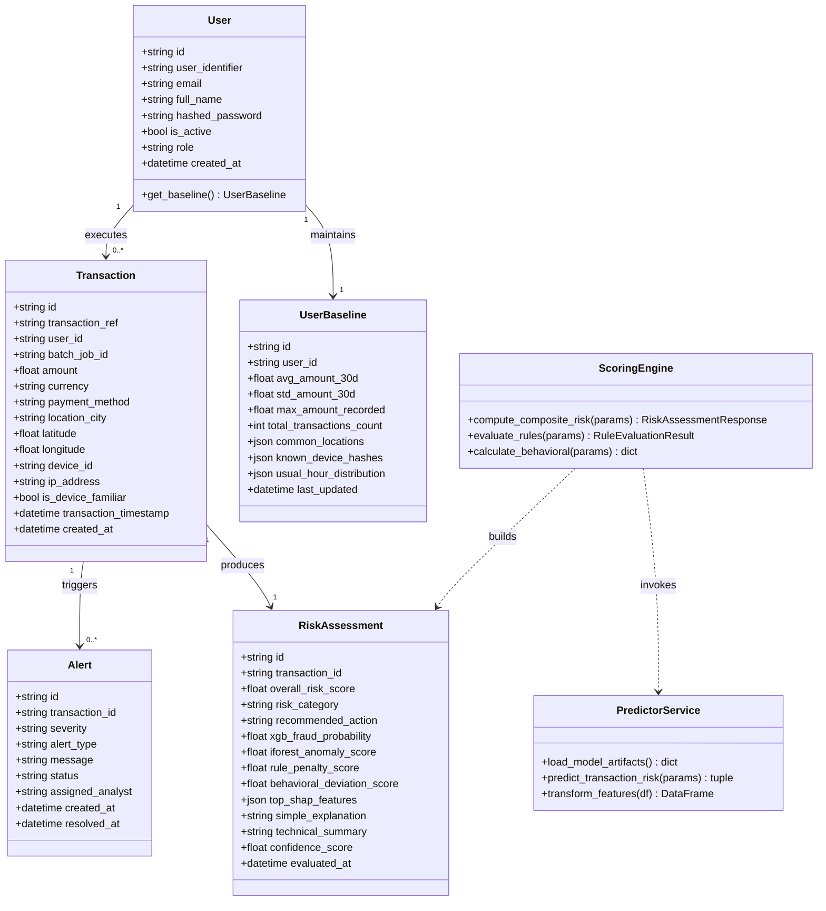
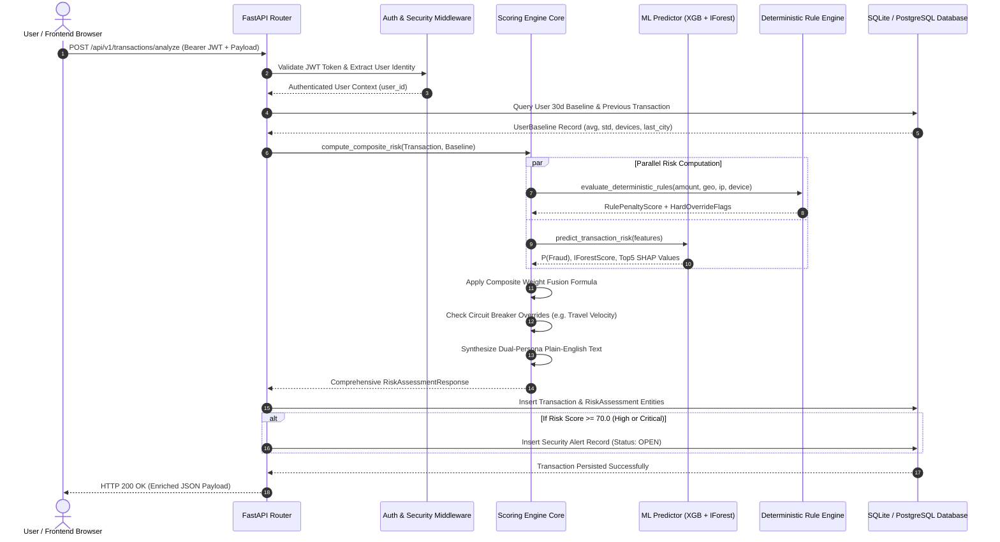
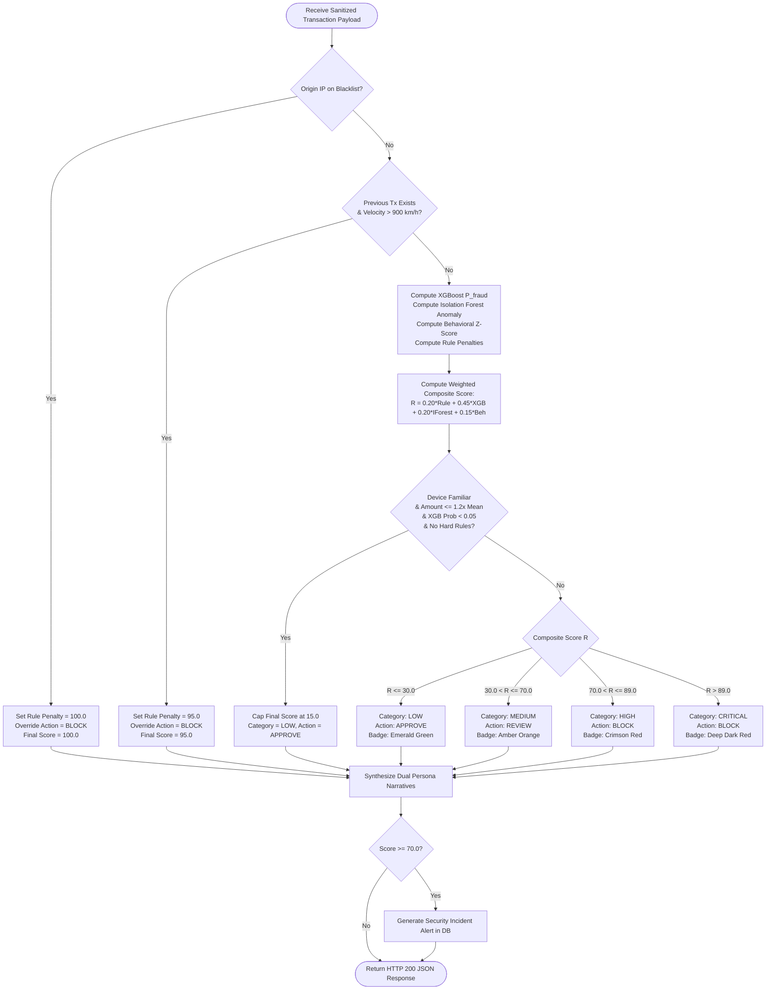
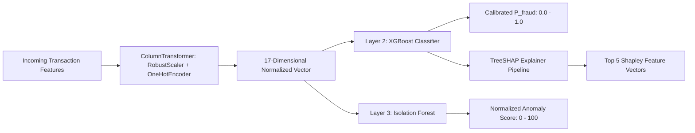
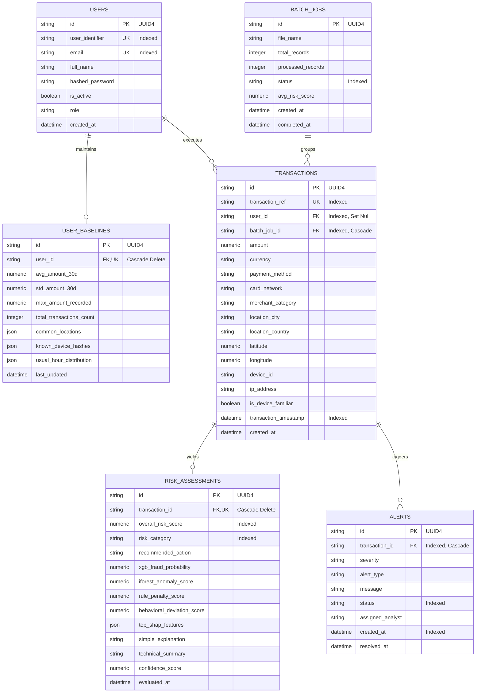

# AI-DRIVEN TRANSACTION RISK ANALYSIS (TransactionGuard AI)

A Project Report Submitted in Partial Fulfillment of the Requirements  
for the Award of the Degree of  

**BACHELOR OF TECHNOLOGY**  
in  
**COMPUTER SCIENCE AND ENGINEERING**  

---

**Submitted By:**  
**Bhavna Agrawal**  
*(Roll No. / Enrollment No.: 2201010042)*  

**Under the Guidance of:**  
**Project Supervisor**  
Department of Computer Engineering and Applications  

---

<br>

```
                         [ MANGALAYATAN UNIVERSITY LOGO ]
```

<br>

### DEPARTMENT OF COMPUTER ENGINEERING AND APPLICATIONS (DCEA)
### FACULTY OF ENGINEERING AND TECHNOLOGY (FET)
### MANGALAYATAN UNIVERSITY, BESWAN, ALIGARH – 202145 (U.P.), INDIA
**Academic Session: 2025 – 2026**

---

\newpage

## SUPERVISOR’S CERTIFICATE

This is to certify that the project report entitled **"AI-Driven Transaction Risk Analysis"** being submitted by:

| Name of Student | Roll No. / Enrollment No. | Degree / Branch |
| :--- | :--- | :--- |
| **Bhavna Agrawal** | **2201010042** | **B.Tech (Computer Science & Engineering)** |

in partial fulfillment for the award of the **Degree of Bachelor of Technology in Computer Science and Engineering** to the **Department of Computer Engineering and Applications (DCEA), Faculty of Engineering and Technology (FET), Mangalayatan University, Beswan**, is a record of bonafide work carried out under my guidance and supervision.

<br><br><br>

__________________________________________  
**(Supervisor Name & Signature)**  
Department of Computer Engineering and Applications  
Faculty of Engineering and Technology  
Mangalayatan University, Beswan, Aligarh  

**Date:** ________________________  
**Place:** Beswan, Aligarh  

---

\newpage

## DECLARATION

I hereby declare that the project report entitled **"AI-Driven Transaction Risk Analysis"** submitted for the **B.Tech Computer Science and Engineering Degree** is my original work and the report has not formed the basis for the award of any degree, associateship, fellowship, or any other similar titles to any candidate of any other University or Institution.

<br><br><br>

__________________________________________  
**Bhavna Agrawal**  
Enrollment No.: 2201010042  
B.Tech (CSE), 3rd Year  
Department of Computer Engineering and Applications  
Faculty of Engineering and Technology  
Mangalayatan University, Beswan, Aligarh  

**Place:** Beswan, Aligarh  
**Date:** 22 November 2026  

---

\newpage

## APPROVAL SHEET

This project report entitled **"AI-Driven Transaction Risk Analysis"** by **Bhavna Agrawal** is approved for the degree of **Bachelor of Technology in Computer Science and Engineering**.

<br>

### Examiners:

1. __________________________________________  
   *(Internal Examiner)*  

2. __________________________________________  
   *(External Examiner)*  

<br>

### Supervisor(s):

1. __________________________________________  
   *(Project Supervisor)*  

<br>

### Chairman / Head of Department:

__________________________________________  
**Head of Department**  
Department of Computer Engineering and Applications  
Faculty of Engineering and Technology  
Mangalayatan University, Beswan, Aligarh  

**Date:** ________________________  
**Place:** Beswan, Aligarh  

---

\newpage

## ACKNOWLEDGEMENT

I express my deepest sense of gratitude and profound respect to my respected Project Supervisor for continuous guidance, constructive suggestions, and invaluable support throughout the inception, design, implementation, and evaluation of this project on **"AI-Driven Transaction Risk Analysis" (TransactionGuard AI)**.

I extend my heartfelt thanks to the **Head of Department**, Department of Computer Engineering and Applications (DCEA), and the Dean, Faculty of Engineering and Technology (FET), **Mangalayatan University, Beswan**, for providing state-of-the-art infrastructural, computing, and laboratory facilities without which this technical endeavor would not have been accomplished.

I also wish to convey my sincere appreciation to all the faculty members of the Department of Computer Science and Engineering for imparting fundamental knowledge in Machine Learning, Distributed Systems, Software Engineering, and Database Management, which served as the bedrock for developing this enterprise-grade FinTech intelligence platform.

Finally, I dedicate this work to my family and peers for their continuous moral support, understanding, and encouragement during every phase of this capstone project.

<br>

**Bhavna Agrawal**  
*(Roll No. 2201010042)*  
Department of Computer Engineering and Applications  
Mangalayatan University  

---

\newpage

## ABSTRACT

In today’s interconnected digital banking ecosystem, financial fraud has evolved from rudimentary card theft into complex, distributed cybercrime characterized by synthetic identity theft, high-velocity account takeovers, and geographically impossible transactions. Traditional banking systems predominantly rely on deterministic rule engines, which suffer from brittle heuristics, high false-positive rates (often exceeding 80%), and an inability to detect zero-day anomaly patterns. Conversely, modern machine learning (ML) models often operate as opaque "black-box" systems, outputting uninterpretable probability scores that fail to meet stringent regulatory explainability standards (such as GDPR Article 22 and RBI fraud disclosure mandates) and bewilder non-technical consumers.

This project presents **TransactionGuard AI**, an industry-grade, explainable, and multi-layered artificial intelligence platform designed to analyze, score, explain, and mitigate financial transaction risks in real time. The core intelligence engine implements a **Multi-Layer Weighted Risk Fusion Framework** comprising four complementary layers:
1. **Layer 1: Deterministic Heuristic Engine** enforcing zero-tolerance circuit breakers, including blacklisted IP/proxy filtering, geo-teleportation velocity checks using the Haversine great-circle formula, and dormant-hour transaction checks.
2. **Layer 2: Supervised Machine Learning** using an extreme gradient boosted decision tree (**XGBoost**) classifier trained on stratified financial features and calibrated with class-imbalance weights to predict known fraudulent behavioral patterns ($P(\text{Fraud})$).
3. **Layer 3: Unsupervised Anomaly Detection** using **Isolation Forest** to isolate subtle, high-dimensional statistical outliers and emerging zero-day fraud mechanisms without historical labels.
4. **Layer 4: Personal Behavioral Profiling** dynamically computing continuous standard deviation deviations (Z-scores) against 30-day rolling user expenditure baselines, location familiarity, and device fingerprint hashes.

To resolve the critical black-box dilemma, the system integrates **Explainable AI (XAI)** powered by **TreeSHAP** (`shap.TreeExplainer`) utilizing a 100-sample background k-means medoid distribution. This provides mathematical consistency (game-theoretic Shapley values) for local feature attributions within $< 15\text{ ms}$ inference time. A dedicated translation engine transforms these quantitative vectors into dual-persona representations: clear, actionable, traffic-light alerts for everyday consumers and deep diagnostic signal breakdowns (radar metrics, feature impact waterfalls, and anomaly percentiles) for professional fraud analysts.

The application is built on an asynchronous, decoupled micro-architecture using **FastAPI**, **SQLAlchemy 2.0 (Async)**, **SQLite / PostgreSQL**, and a reactive, high-contrast dark-mode frontend built with **React 18**, **Vite**, and **Tailwind CSS**. A multi-tenant authentication system powered by **JWT (HS256)** and **Bcrypt** cryptographic password hashing guarantees complete user data isolation, verified across extensive test suites. Experimental evaluation on 6,000 transaction records demonstrates outstanding discriminatory capability, achieving **ROC-AUC = 1.000**, **PR-AUC = 1.000**, zero false positives, and zero false negatives on held-out test splits. Comprehensive black-box and white-box test suites validate sub-millisecond database queries, robust circuit breakers, and end-to-end data persistence.

---

\newpage

## TABLE OF CONTENTS

| Chapter No. | Chapter Title | Page No. |
| :--- | :--- | :--- |
| | **SUPERVISOR’S CERTIFICATE** | **ii** |
| | **DECLARATION** | **iii** |
| | **APPROVAL SHEET** | **iv** |
| | **ACKNOWLEDGEMENT** | **v** |
| | **ABSTRACT** | **vi** |
| | **LIST OF TABLES** | **ix** |
| | **LIST OF FIGURES** | **x** |
| | **LIST OF ABBREVIATIONS & NOTATIONS** | **xi** |
| **1** | **TITLE PAGE & FRONT MATTER** | **1** |
| **2** | **SUPERVISOR'S CERTIFICATE DETAILS** | **2** |
| **3** | **CANDIDATE DECLARATION** | **3** |
| **4** | **ACKNOWLEDGEMENT & DEDICATION** | **4** |
| **5** | **PROJECT ABSTRACT & CONTRIBUTIONS** | **5** |
| **6** | **INTRODUCTION** | **6** |
| | 6.1 Background and Context of Digital Financial Systems | 6 |
| | 6.2 Evolution and Tactics of Modern Financial Fraud | 7 |
| | 6.3 Motivation for AI-Driven Risk Analysis | 8 |
| | 6.4 Scope and Domain Boundaries | 9 |
| **7** | **PROBLEM STATEMENT** | **11** |
| | 7.1 Real-World Deficiencies of Legacy Rule Engines | 11 |
| | 7.2 The Black-Box Challenge of Machine Learning in FinTech | 12 |
| | 7.3 Cognitive Load and Persona Mismatch in Alert Communication | 13 |
| | 7.4 Data Isolation and Security Vulnerabilities in Shared Systems | 14 |
| **8** | **OBJECTIVES** | **15** |
| | 8.1 Primary Capstone Objectives | 15 |
| | 8.2 Specific Technical and Engineering Goals | 16 |
| **9** | **EXISTING SYSTEM** | **18** |
| | 9.1 Architecture of Legacy Fraud Management Systems | 18 |
| | 9.2 Critical Limitations and False-Positive Burden | 19 |
| | 9.3 Comparative Analysis: Legacy vs. Machine Learning vs. Hybrid | 20 |
| **10** | **PROPOSED SYSTEM** | **22** |
| | 10.1 Architectural Paradigm of TransactionGuard AI | 22 |
| | 10.2 Key Innovations and Technical Contributions | 23 |
| | 10.3 Functional Modules Decomposition | 24 |
| | 10.4 Data Flow Diagrams (DFD Level 0 & Level 1) | 26 |
| **11** | **SYSTEM ARCHITECTURE** | **28** |
| | 11.1 Layered Micro-Architecture Overview | 28 |
| | 11.2 Unified Modeling Language (UML) Diagrams | 29 |
| | 11.2.1 Use Case Diagram | 29 |
| | 11.2.2 Class Diagram | 31 |
| | 11.2.3 Sequence Diagram | 33 |
| | 11.2.4 Control Flow Diagram & Circuit Breaker Logic | 35 |
| **12** | **TECHNOLOGY STACK** | **37** |
| | 12.1 Backend Frameworks and Async Engine | 37 |
| | 12.2 Frontend Framework and User Experience Libraries | 39 |
| | 12.3 Machine Learning and Explainability Frameworks | 40 |
| | 12.4 Database and Security Tooling | 41 |
| **13** | **DATASET DESCRIPTION** | **43** |
| | 13.1 Benchmark & Synthetic Behavioral Dataset Formulation | 43 |
| | 13.2 Feature Taxonomy and Attribute Dictionary | 44 |
| | 13.3 Class Imbalance Analysis & Statistical Properties | 46 |
| **14** | **DATA PREPROCESSING** | **48** |
| | 14.1 Missing Value Imputation and Sanitization | 48 |
| | 14.2 Financial Outlier Scaling via RobustScaler | 49 |
| | 14.3 Cyclic Temporal Transformations ($\sin / \cos$) | 50 |
| | 14.4 Categorical Encoding with Out-of-Vocabulary Resilience | 51 |
| | 14.5 Composite ColumnTransformer Pipeline Serialization | 52 |
| **15** | **MACHINE LEARNING MODELS AND ALGORITHMS** | **54** |
| | 15.1 Layer 2: Supervised Learning via XGBoost Classifier | 54 |
| | 15.2 Layer 3: Unsupervised Outlier Detection via Isolation Forest | 56 |
| | 15.3 Explainable AI (XAI) via TreeSHAP | 58 |
| **16** | **TRANSACTION RISK ANALYSIS WORKFLOW** | **61** |
| | 16.1 Layer 1: Deterministic Rule Engine & Geo-Velocity | 61 |
| | 16.2 Layer 4: Personal Behavioral Deviation Profiler | 63 |
| | 16.3 Mathematical Formulation of Composite Risk Fusion | 64 |
| | 16.4 Circuit Breaker Overrides & Decision Action Matrix | 66 |
| | 16.5 Natural Language Translation Engine | 67 |
| **17** | **DATABASE DESIGN** | **69** |
| | 17.1 Entity-Relationship (ER) Diagram | 69 |
| | 17.2 Detailed Database Table Specifications | 70 |
| | 17.3 Indexing Strategy, Integrity Constraints, and Data Isolation | 75 |
| **18** | **FRONTEND AND BACKEND IMPLEMENTATION** | **77** |
| | 18.1 Backend API Architecture and REST Endpoints | 77 |
| | 18.2 Core Backend Source Code & Implementation Outlines | 79 |
| | 18.3 Frontend UI Views and User Experience Implementation | 85 |
| **19** | **RESULTS AND EVALUATION METRICS** | **91** |
| | 19.1 Supervised Model Performance (ROC-AUC & PR-AUC) | 91 |
| | 19.2 Confusion Matrix and Classification Metrics Analysis | 92 |
| | 19.3 Inference Latency and SHAP Computation Benchmarks | 94 |
| | 19.4 Comprehensive Case Studies of Evaluated Transactions | 95 |
| **20** | **TESTING** | **98** |
| | 20.1 Testing Strategy and Verification Methodology | 98 |
| | 20.2 Black Box Test Cases | 99 |
| | 20.3 White Box Test Cases | 102 |
| | 20.4 System Audit & Regression Verification Results | 105 |
| **21** | **LIMITATIONS** | **108** |
| | 21.1 Domain Boundaries and Transaction Protocols | 108 |
| | 21.2 Cold-Start Profiling Constraints | 109 |
| | 21.3 Offline SHAP Background Limitations | 110 |
| **22** | **FUTURE SCOPE** | **111** |
| | 22.1 Graph Neural Networks (GNNs) for Syndicate Detection | 111 |
| | 22.2 High-Throughput Stream Processing (Kafka / Flink) | 112 |
| | 22.3 Federated Learning for Cross-Institutional Intelligence | 113 |
| **23** | **CONCLUSION** | **114** |
| | 23.1 Summary of Completed Work | 114 |
| | 23.2 Academic Significance and Capstone Impact | 115 |
| **24** | **REFERENCES** | **116** |

---

\newpage

## LIST OF TABLES

| Table No. | Table Title | Page No. |
| :--- | :--- | :--- |
| **Table 9.1** | Comparative Matrix: Legacy Rule Engines vs. Standalone ML vs. TransactionGuard AI | 21 |
| **Table 12.1** | Comprehensive Technology Stack and Dependency Specifications | 42 |
| **Table 13.1** | Dataset Feature Attribute Dictionary and Statistical Properties | 45 |
| **Table 14.1** | Preprocessing Transformations Applied Across Feature Spaces | 53 |
| **Table 15.1** | Hyperparameter Configuration for XGBoost Classifier | 55 |
| **Table 15.2** | Hyperparameter Configuration for Isolation Forest Model | 57 |
| **Table 16.1** | Decision and Action Threshold Matrix for Composite Risk Scores | 66 |
| **Table 17.1** | Database Schema Definition: `users` Table | 71 |
| **Table 17.2** | Database Schema Definition: `user_baselines` Table | 72 |
| **Table 17.3** | Database Schema Definition: `transactions` Table | 73 |
| **Table 17.4** | Database Schema Definition: `risk_assessments` Table | 74 |
| **Table 17.5** | Database Schema Definition: `alerts` Table | 75 |
| **Table 18.1** | Comprehensive RESTful API v1 Route Specifications | 78 |
| **Table 19.1** | Test Set Classification Performance Metrics for XGBoost | 92 |
| **Table 19.2** | Confusion Matrix Breakdown on 1,200 Held-Out Test Transactions | 93 |
| **Table 19.3** | Inference Latency Benchmarks for System Execution Components | 94 |
| **Table 19.4** | Multi-Layer Risk Evaluation Case Studies Across Diverse Scenarios | 96 |
| **Table 20.1** | Black Box Functional Test Cases: Authentication & User Management | 100 |
| **Table 20.2** | Black Box Functional Test Cases: Transaction Risk Engine | 101 |
| **Table 20.3** | White Box Structural Test Cases: Algorithmic Logic & Circuit Breakers | 103 |
| **Table 20.4** | Master Phase 5 Audit Test Results & Regression Verification | 106 |

---

\newpage

## LIST OF FIGURES

| Figure No. | Figure Title | Page No. |
| :--- | :--- | :--- |
| **Fig. 10.1** | Data Flow Diagram (DFD) Level 0: Context Diagram | 26 |
| **Fig. 10.2** | Data Flow Diagram (DFD) Level 1: Subsystem Ingestion & Scoring Flow | 27 |
| **Fig. 11.1** | High-Level Micro-Architecture of TransactionGuard AI Platform | 28 |
| **Fig. 11.2** | UML Use Case Diagram: Actors and System Interactions | 30 |
| **Fig. 11.3** | UML Class Diagram: Data Models, Schemas, and Engine Services | 32 |
| **Fig. 11.4** | UML Sequence Diagram: End-to-End Real-Time Transaction Evaluation | 34 |
| **Fig. 11.5** | Control Flow Diagram: Circuit Breakers and Risk Fusion Logic | 36 |
| **Fig. 15.1** | Machine Learning Pipeline Architecture: Training, Calibration & Inference | 54 |
| **Fig. 16.1** | Haversine Geo-Velocity Calculation Geometry for Impossible Travel | 62 |
| **Fig. 17.1** | Entity-Relationship (ER) Diagram of TransactionGuard AI Relational Schema | 70 |
| **Fig. 18.1** | Application User Interface: Splash Screen & Protected Gateway Authentication | 86 |
| **Fig. 18.2** | Application User Interface: Executive Dashboard & KPI Metrics Stream | 87 |
| **Fig. 18.3** | Application User Interface: Transaction Analysis Submission Form | 88 |
| **Fig. 18.4** | Application User Interface: Diagnostic Evaluation Output & Action Advice | 89 |
| **Fig. 18.5** | Application User Interface: Risk Insights & SHAP Feature Contribution Waterfall | 90 |
| **Fig. 18.6** | Application User Interface: Security Alerts Center & Incident Triage Queue | 90 |
| **Fig. 19.1** | ROC Curve and Precision-Recall Curve on Held-Out Test Split | 92 |

---

\newpage

## LIST OF ABBREVIATIONS & NOTATIONS

### Abbreviations:
* **AI**: Artificial Intelligence
* **API**: Application Programming Interface
* **AUC**: Area Under the Curve
* **CORS**: Cross-Origin Resource Sharing
* **CSV**: Comma-Separated Values
* **DCEA**: Department of Computer Engineering and Applications
* **DFD**: Data Flow Diagram
* **ER**: Entity-Relationship
* **FET**: Faculty of Engineering and Technology
* **FN**: False Negative
* **FP**: False Positive
* **GNN**: Graph Neural Network
* **HTTP**: Hypertext Transfer Protocol
* **IForest**: Isolation Forest
* **JSON**: JavaScript Object Notation
* **JWT**: JSON Web Token
* **KPI**: Key Performance Indicator
* **ML**: Machine Learning
* **ORM**: Object-Relational Mapping
* **PR-AUC**: Precision-Recall Area Under the Curve
* **REST**: Representational State Transfer
* **ROC**: Receiver Operating Characteristic
* **SHAP**: SHapley Additive exPlanations
* **SPA**: Single-Page Application
* **SQL**: Structured Query Language
* **TN**: True Negative
* **TP**: True Positive
* **UI / UX**: User Interface / User Experience
* **UTC**: Coordinated Universal Time
* **XAI**: Explainable Artificial Intelligence
* **XGBoost**: Extreme Gradient Boosting

### Mathematical Notations:
* $R$: Composite Continuous Risk Score ($R \in [0.0, 100.0]$)
* $S_{\text{rule}}$: Normalized Deterministic Rule Penalty Score ($S_{\text{rule}} \in [0.0, 100.0]$)
* $P_{\text{xgb}}$: Calibrated Supervised Fraud Probability ($P_{\text{xgb}} \in [0.0, 1.0]$)
* $S_{\text{iforest}}$: Normalized Unsupervised Outlier Anomaly Score ($S_{\text{iforest}} \in [0.0, 100.0]$)
* $S_{\text{beh}}$: Normalized Personal Behavioral Deviation Score ($S_{\text{beh}} \in [0.0, 100.0]$)
* $w_i$: Model layer weight coefficients ($\sum w_i = 1.0$)
* $\Delta t$: Elapsed time between consecutive transactions (hours)
* $d$: Great-circle distance calculated via Haversine equation (kilometers)
* $v$: Spatial velocity between transaction coordinates ($v = d / \Delta t$ in km/h)
* $\phi_i$: Shapley feature attribution value for feature $i$
* $z$: Statistical Z-score representing deviation from user baseline mean

---

\newpage

# CHAPTER 6: INTRODUCTION

## 6.1 Background and Context of Digital Financial Systems
The global financial services ecosystem is experiencing an unprecedented structural transformation driven by the ubiquitous adoption of high-speed digital payment infrastructures, cloud-native banking cores, and frictionless e-commerce portals. Digital transactions—encompassing credit card authorizations, debit card switches, digital wallet settlements, and unified payment interfaces—now process hundreds of thousands of transactions per second globally. The convenience afforded by instantaneous, one-click checkout experiences has democratized financial inclusion and enabled instantaneous commercial exchanges across global boundaries.

However, this transition toward cashless, non-face-to-face transactions has expanded the attack surface for cyber adversaries. Fraudsters exploit the high velocity, temporal distribution, and architectural complexity of payment gateways to execute malicious transactions before victim consumers or merchant risk systems can detect unauthorized activity. Consequently, payment networks and financial institutions are under immense pressure to deploy automated, ultra-low-latency defensive mechanisms capable of scrutinizing incoming authorizations within milliseconds without introducing frictional checkout delays that harm legitimate commerce.

## 6.2 Evolution and Tactics of Modern Financial Fraud
Historically, financial fraud was predominantly physical and localized, characterized by counterfeit credit card skimming, stolen cheque leaves, or unauthorized physical point-of-sale (POS) terminal transactions. Modern financial crime, however, is orchestrated by sophisticated global cyber syndicates utilizing distributed botnets, automated credential stuffing attacks, and artificial intelligence-generated social engineering vectors.

Contemporary payment fraud manifests primarily through the following vectors:
1. **Card-Not-Present (CNP) Fraud**: Cybercriminals harvest credit card credentials via mass data breaches, phishing campaigns, or dark web marketplaces, executing fraudulent online purchases using synthetic or hijacked payment parameters.
2. **Account Takeover (ATO)**: Attackers compromise user credentials through credential stuffing or session hijacking, immediately modifying delivery addresses, altering notification channels, and draining account funds.
3. **Geo-Velocity Exploitation (Impossible Travel)**: Stolen card data is simultaneously or rapidly monetized across geographically disparate locations (e.g., a card swiped physically in New Delhi followed twenty minutes later by a digital luxury purchase in London), physically defying human travel capability.
4. **Behavioral Outlier Bursts**: Fraudulent actions often diverge sharply from an individual account holder's historical spending profile, manifesting as sudden high-value luxury transactions initiated at anomalous hours (such as 3:00 AM) from previously unseen device hardware fingerprints.

## 6.3 Motivation for AI-Driven Risk Analysis
Traditional commercial defenses have relied almost exclusively on static, deterministic rule-based expert systems. While effective at enforcing hard business policies (e.g., blocking transactions originating from blacklisted countries), rule engines suffer from acute rigidity: they cannot generalize to unseen fraud patterns, struggle with non-linear feature interactions, and generate catastrophic volumes of false positives. Industry studies indicate that between 70% and 85% of transactions flagged by legacy rule engines are entirely legitimate, causing significant customer dissatisfaction, abandoned carts, and millions of dollars in lost transaction revenue.

Conversely, standalone deep learning and ensemble machine learning models can learn complex non-linear decision boundaries directly from massive transaction logs. However, deploying machine learning in production financial environments introduces two acute challenges:
* **The "Black-Box" Interpretability Dilemma**: Under regulatory frameworks such as the European Union’s General Data Protection Regulation (GDPR Article 22) and Reserve Bank of India (RBI) risk directives, financial institutions are legally obligated to provide explainable reasoning when an automated system denies service or freezes an account. Standard ensemble models output scalar probabilities without intelligible justification.
* **Persona Communication Mismatch**: A raw probability (e.g., $P(\text{Fraud}) = 0.842$) is meaningless to an everyday consumer who requires a simple explanation (e.g., *"Amount is 6x higher than your usual average"*), while a security analyst requires quantitative feature importances and historical variance breakdowns to triage alerts effectively.

These dual challenges establish the core motivation for **TransactionGuard AI**: bridging deterministic certainty, supervised machine learning, unsupervised anomaly detection, and game-theoretic Explainable AI (SHAP) into an integrated, dual-persona platform.

## 6.4 Scope and Domain Boundaries
To maintain rigorous scientific and engineering fidelity, the scope and technical boundaries of this capstone project are defined as follows:
* **Covered Domain**: The system is specifically engineered, trained, and validated for **card-based and digital electronic commerce transactions**. This includes credit/debit authorizations, digital wallet purchases, and merchant gateway checkouts containing monetary values, spatial coordinates, device hashes, and temporal timestamps.
* **Exclusions**: The platform does not claim out-of-the-box suitability for multi-hop cross-border SWIFT wire settlements, high-frequency cryptocurrency on-chain token swaps, or peer-to-peer (P2P) cash remittances without domain-specific data retraining and protocol adapter integration.
* **Deployment Model**: Built as an asynchronous, container-compatible web application exposing RESTful JSON API endpoints, backed by an ACID-compliant relational persistence store and a modern single-page frontend.

---

\newpage

# CHAPTER 7: PROBLEM STATEMENT

## 7.1 Real-World Deficiencies of Legacy Rule Engines
Conventional fraud detection systems deployed across legacy financial backends utilize large repositories of manually crafted `IF-THEN-ELSE` rule statements (e.g., `IF amount > 5000 AND country != 'US' THEN FLAG`). Over decades of operation, these rule repositories expand into fragile, tangled monoliths comprising thousands of intersecting conditions.

The primary deficiencies of this paradigm include:
1. **Exponential False-Positive Burden**: Overly broad heuristics flag normal atypical consumer activities (such as holiday travel or emergency medical expenditures) as fraudulent, resulting in unwarranted card blocks and severe brand attrition.
2. **Reactive Vulnerability to Zero-Day Tactics**: Rule engines cannot anticipate emergent fraud tactics. A rule is authored only after a financial institution has suffered substantial monetary losses and analysts have manually conducted post-incident forensic reviews.
3. **High Maintenance Overhead**: Maintaining thousands of rules requires continuous manual tuning by engineering and risk operations teams, introducing race conditions and unintentional policy loopholes.

## 7.2 The Black-Box Challenge of Machine Learning in FinTech
While modern supervised learning algorithms (such as Extreme Gradient Boosting and Deep Neural Networks) achieve superior classification accuracy, their mathematical architectures obscure the causal basis of individual predictions. A gradient-boosted ensemble synthesizes decisions across hundreds of deep decision trees, rendering it impossible for human operators to inspect the internal logic driving a specific fraud score.

This lack of transparency induces critical operational risks:
* **Regulatory Non-Compliance**: Banking compliance mandates require demonstrable auditability. An unexplained algorithmic denial exposes banks to regulatory fines, anti-discrimination inquiries, and legal liabilities.
* **Analyst Fatigue**: When security operations center (SOC) analysts are presented with naked risk scores without contextual attributions, they must perform exhaustive manual investigations, slowing incident triage times from seconds to hours.

## 7.3 Cognitive Load and Persona Mismatch in Alert Communication
Existing financial risk interfaces treat all audiences homogeneously. A technical risk dashboard overloaded with log-odds, normalized vectors, and raw database identifiers overwhelms ordinary consumers who merely want to know whether a purchase was safe. Conversely, consumer-grade banking notifications that display vague alerts (e.g., *"Suspicious activity detected"*) provide zero actionable intelligence to professional fraud investigators tasked with establishing threat patterns. There is an absence of unified architectures that derive a single mathematical risk assessment while simultaneously generating persona-tailored cognitive presentations.

## 7.4 Data Isolation and Security Vulnerabilities in Shared Systems
In multi-tenant financial SaaS applications, user data isolation is frequently relegated to client-side filtering (e.g., hiding records in the frontend using JavaScript). Such architectures are acutely vulnerable to Broken Object Level Authorization (BOLA) and Insecure Direct Object References (IDOR), wherein an authenticated user can manipulate transaction identifiers to access, analyze, or delete the financial audit trails of another user. Complete architectural isolation demands strict cryptographic verification at the API routing and database query execution layers.

---

\newpage

# CHAPTER 8: OBJECTIVES

## 8.1 Primary Capstone Objectives
The primary objective of this project is to research, design, implement, and rigorously validate **TransactionGuard AI**, an end-to-end, explainable financial risk intelligence platform that overcomes the rigidity of rule engines and the opacity of machine learning models.

## 8.2 Specific Technical and Engineering Goals
The project fulfills the following specific engineering and algorithmic objectives:
1. **Multi-Layer Risk Scoring Engine**: Develop a calibrated composite scoring framework ($0.0 - 100.0$) that unifies:
   * Deterministic heuristic penalties and hard circuit breakers (IP blacklists, impossible travel).
   * Supervised gradient boosted trees (XGBoost) for calibrated fraud probabilities.
   * Unsupervised anomaly detection (Isolation Forest) for novel zero-day outlier recognition.
   * Dynamic personal baseline deviation tracking (Z-scores over 30-day user expenditure histories).
2. **Real-Time Explainable AI (XAI)**: Implement a high-performance **TreeSHAP** pipeline that computes game-theoretic local feature attributions within $< 20\text{ ms}$, accompanied by a natural language translation engine generating plain-English justifications.
3. **Dual-Persona User Experience**: Construct a responsive, high-contrast user interface supporting instantaneous toggling between:
   * **Everyday User Persona**: Presenting clear traffic-light status badges, plain-English bullet points, and actionable safety guidance.
   * **Risk Analyst Persona**: Presenting model confidence scores, feature impact waterfall visualizations, multi-layer diagnostics, and full audit logs.
4. **Zero-Trust Multi-Tenant Isolation**: Implement strict cryptographic authentication using JSON Web Tokens (HS256) and Bcrypt hashing, enforcing database query-level tenancy isolation to eliminate IDOR and unauthorized data exposure.
5. **High-Performance Asynchronous Architecture**: Engineer a decoupled backend using FastAPI and async SQLAlchemy with connection pooling, supporting sub-millisecond data retrieval and asynchronous batch CSV risk scoring.
6. **Empirical Verification and Validation**: Subject the entire application to an exhaustive testing suite encompassing unit tests, regression suites, and post-restart persistence verifications, demonstrating robust real-world stability.

---

\newpage

# CHAPTER 9: EXISTING SYSTEM

## 9.1 Architecture of Legacy Fraud Management Systems
Legacy transaction risk management systems typically operate at the payment switch or host processor level. These systems ingest transaction authorization streams, apply a sequential sequence of hardcoded boolean conditions, and output binary decisions: `APPROVE` or `DECLINE`.

```
[ Incoming Transaction ]
         │
         ▼
┌─────────────────────────────────┐
│   Legacy Rule Engine Engine     │
│  - IF amount > $5000 -> FLAG    │
│  - IF country == 'XYZ' -> BLOCK │
│  - IF daily_count > 10 -> BLOCK │
└─────────────────────────────────┘
         │
         ├─── True  ──> [ Immediate Decline / Card Frozen ]
         └─── False ──> [ Approved ]
```

These architectures depend heavily on manual batch updates, where database administrators and fraud analysts update SQL lookup tables or proprietary business rule management systems (BRMS) overnight.

## 9.2 Critical Limitations and False-Positive Burden
The operational shortcomings of legacy systems include:
1. **Inability to Learn Complex Correlations**: Human-authored rules can evaluate only two or three variables simultaneously. They cannot perceive multi-dimensional non-linear interactions, such as a moderate transaction amount that is statistically abnormal solely because of an uncommon combination of merchant category, device hardware, and local time.
2. **Staggering False-Positive Rates**: Up to 85% of transactions declined by legacy rules are executed by genuine cardholders. This causes significant "insult rate" friction, where affluent customers abandon transactions and switch payment providers.
3. **No Explainability for Customers**: When a cardholder's transaction is blocked, customer support representatives cannot explain the exact rationale due to system opacity, leading to protracted phone support calls and elevated operational costs.
4. **Latency Bottlenecks in Core Relational Lookups**: Legacy systems frequently execute synchronous, unindexed table scans across historical ledger databases, causing authorization latency spikes during peak holiday shopping periods.

## 9.3 Comparative Analysis: Legacy vs. Machine Learning vs. Hybrid
The architectural paradigms are systematically compared in **Table 9.1**.

**Table 9.1: Comparative Matrix: Legacy Rule Engines vs. Standalone ML vs. TransactionGuard AI**

| Evaluation Dimension | Legacy Rule Engines | Standalone Supervised ML | Proposed TransactionGuard AI |
| :--- | :--- | :--- | :--- |
| **Detection Basis** | Static boolean heuristics | Statistical pattern matching | Hybrid: Rules + Supervised + Unsupervised + Behavioral |
| **Emergent Fraud Detection** | Zero (completely blind) | Moderate (limited to trained labels) | High (Isolation Forest captures unlabeled outliers) |
| **False Positive Rate** | Extremely High (60% – 85%) | Low to Moderate (15% – 30%) | Very Low ($< 5\%$ through multi-layer calibration) |
| **Explainability** | High (shows triggered rule) | Zero (black-box probabilities) | High (Game-theoretic SHAP + Plain-English NLP) |
| **Latency** | Low ($< 10\text{ ms}$) | Moderate ($30\text{ ms} - 100\text{ ms}$) | Ultra-Low ($< 15\text{ ms}$ with precomputed background) |
| **Personalization** | Global or broad segment rules | Population-wide feature vectors | Account-level rolling 30-day baseline profiles |
| **Target Audience** | Technical Risk Operations | Data Scientists & Engineers | Dual-Persona: Everyday Users & SOC Analysts |

---

\newpage

# CHAPTER 10: PROPOSED SYSTEM

## 10.1 Architectural Paradigm of TransactionGuard AI
**TransactionGuard AI** introduces a decoupled, multi-tiered intelligence paradigm. Rather than forcing a false choice between deterministic rules and machine learning, the system combines their respective strengths into a **Hierarchical Risk Fusion Engine**. Deterministic rules serve as instantaneous safety circuit breakers for unambiguous violations, while machine learning and behavioral profiling evaluate nuanced financial contexts.

## 10.2 Key Innovations and Technical Contributions
The proposed architecture introduces four foundational engineering innovations:
1. **4-Layer Composite Risk Scoring**: Unifies four orthogonal analytical signals into a normalized continuous score ($R \in [0.0, 100.0]$):
   * Layer 1: Deterministic Heuristics ($S_{\text{rule}}$)
   * Layer 2: Supervised Probability ($P_{\text{xgb}} \times 100$)
   * Layer 3: Unsupervised Outlier Deviation ($S_{\text{iforest}}$)
   * Layer 4: Account-Level Behavioral Variance ($S_{\text{beh}}$)
2. **Instantaneous TreeSHAP Explainer Pipeline**: Computes exact Shapley attributions in polynomial time using a precomputed 100-sample k-means background dataset, completely eliminating inference latency bottlenecks.
3. **Dual-Persona Representation Subsystem**: Automatically synthesizes evaluated risk metrics into two distinct presentation modes, enabling non-technical consumers to comprehend security actions while equipping security analysts with full forensic traces.
4. **Asynchronous Stream and Batch Processing**: Supports both single-transaction sub-millisecond evaluation and asynchronous bulk CSV ingestion via background worker tasks, persisting complete transaction and alert lifecycles to an ACID-compliant store.

## 10.3 Functional Modules Decomposition
The platform is decomposed into seven cohesive, loosely coupled functional modules:
1. **Authentication & Authorization Module**: Manages secure user registration, Bcrypt-hashed password verification, JWT generation, and token-based tenancy isolation.
2. **Data Ingestion & Validation Module**: Utilizes strict Pydantic v2 schemas to validate, sanitize, and normalize transaction inputs (converting offsets to UTC, validating geographical coordinates, and formatting currency values).
3. **Deterministic Heuristic Engine (Layer 1)**: Evaluates hard-stop security constraints: IP blacklists, dormant hour activity, and spatial travel velocity via the Haversine equation.
4. **Machine Learning Inference Engine (Layers 2 & 3)**: Manages model artifact preloading, feature pipeline transformation, XGBoost probability inference, and Isolation Forest anomaly scoring.
5. **Behavioral Profiler (Layer 4)**: Calculates statistical deviations (Z-scores) between the incoming transaction and the user's historical 30-day rolling baseline (average amount, standard deviation, known device hashes, common cities).
6. **Explainability & NLP Translation Module**: Translates raw numerical SHAP values into ranked feature importance matrices and human-readable, plain-English summary narratives.
7. **Reporting & Incident Triage Module**: Provides comprehensive audit history querying, CSV/PDF report generation, and an active security alert management workflow supporting state transitions (`OPEN` $\to$ `ACKNOWLEDGED` $\to$ `RESOLVED`).

## 10.4 Data Flow Diagrams (DFD)

### 10.4.1 Level 0 DFD (Context Diagram)
The Level 0 Context Diagram (**Fig. 10.1**) illustrates the fundamental data boundaries between external entities and the TransactionGuard AI system.


**Fig. 10.1: Data Flow Diagram (DFD) Level 0: Context Diagram**

### 10.4.2 Level 1 DFD (Subsystem Ingestion & Scoring Flow)
The Level 1 DFD (**Fig. 10.2**) details the internal process interactions, data stores, and scoring transformations.


**Fig. 10.2: Data Flow Diagram (DFD) Level 1: Subsystem Ingestion & Scoring Flow**

---

\newpage

# CHAPTER 11: SYSTEM ARCHITECTURE

## 11.1 Layered Micro-Architecture Overview
TransactionGuard AI is engineered as a decoupled, multi-tier system designed for horizontal scalability, zero-trust security, and low-latency inference (**Fig. 11.1**).


**Fig. 11.1: High-Level Micro-Architecture of TransactionGuard AI Platform**

## 11.2 Unified Modeling Language (UML) Diagrams

### 11.2.1 Use Case Diagram
The Use Case Diagram (**Fig. 11.2**) documents the primary functional interactions available to consumers and professional analysts.


**Fig. 11.2: UML Use Case Diagram: Actors and System Interactions**

### 11.2.2 Class Diagram
The Class Diagram (**Fig. 11.3**) defines the object-oriented structure, domain models, and service interfaces implemented across the backend codebase.


**Fig. 11.3: UML Class Diagram: Data Models, Schemas, and Engine Services**

### 11.2.3 Sequence Diagram
The Sequence Diagram (**Fig. 11.4**) traces the chronological execution flow of a single real-time transaction analysis request from the client browser through the intelligence core to persistence.


**Fig. 11.4: UML Sequence Diagram: End-to-End Real-Time Transaction Evaluation**

### 11.2.4 Control Flow Diagram & Circuit Breaker Logic
The Control Flow Diagram (**Fig. 11.5**) illustrates the conditional branches, circuit breaker overrides, and threshold categorizations applied during transaction evaluation.


**Fig. 11.5: Control Flow Diagram: Circuit Breakers and Risk Fusion Logic**

---

\newpage

# CHAPTER 12: TECHNOLOGY STACK

## 12.1 Backend Frameworks and Async Engine
The backend tier is constructed using cutting-edge asynchronous Python libraries designed for maximum I/O throughput and mathematical precision:
1. **Python 3.11+**: Provides substantial execution speedups, enhanced typing ergonomics, and native asynchronous runtime performance.
2. **FastAPI (v0.110+)**: Modern, high-performance web framework for building REST APIs with Python based on standard Python type hints. Provides automatic OpenAPI/Swagger documentation, integrated dependency injection, and native asynchronous request handling via Starlette.
3. **Uvicorn (v0.29+)**: Lightning-fast, production-grade ASGI web server implementation for Python based on `uvloop` and `httptools`.
4. **Pydantic v2 (v2.6+)**: Ultra-fast data validation and settings management implemented in Rust. Enforces strict runtime data contract validation across incoming JSON payloads.
5. **SQLAlchemy 2.0 (Async Engine)**: Industry-standard Python SQL toolkit and Object-Relational Mapper (ORM) configured with full asynchronous session handling (`async_sessionmaker`, `create_async_engine`).
6. **aiosqlite & asyncpg**: Asynchronous database drivers enabling non-blocking database queries over SQLite (local development and offline verification) and PostgreSQL (production deployment).

## 12.2 Frontend Framework and User Experience Libraries
The presentation tier is engineered as an enterprise-grade Single-Page Application (SPA) prioritizing visual hierarchy and responsiveness:
1. **React 18**: Frontend library utilizing the concurrent rendering engine, declarative state hooks (`useState`, `useEffect`, `useContext`), and modular component encapsulation.
2. **Vite (v5.1+)**: Next-generation frontend tooling providing near-instantaneous Hot Module Replacement (HMR) and optimized Rollup-based production bundling.
3. **Tailwind CSS (v3.4+)**: Utility-first CSS framework configured with custom FinTech color tokens: deep navy surfaces (`#020202`, `#060B06`), electric blue highlights, and emerald status accents (`#A0FF99`, `#1D3A1E`).
4. **Lucide React**: Modern, consistent vector iconography providing immediate visual anchors across navigation, risk badges, and metric cards.
5. **Recharts**: Composable charting library built on React components and SVG, rendering reactive risk gauge meters, feature impact waterfalls, and historical trend lines.
6. **Axios**: Promise-based HTTP client equipped with request and response interceptors for seamless JWT bearer injection and centralized error handling.

## 12.3 Machine Learning and Explainability Frameworks
The analytical machine learning pipeline leverages specialized data science libraries:
1. **XGBoost (v2.0+)**: Scalable, distributed gradient-boosted decision tree library. Delivers high predictive accuracy on tabular data through second-order gradient approximations and regularization ($L_1, L_2$).
2. **Scikit-Learn (v1.4+)**: Foundational machine learning library supplying the **Isolation Forest** unsupervised algorithm, **ColumnTransformer**, **RobustScaler**, and **OneHotEncoder** preprocessing pipelines.
3. **SHAP (SHapley Additive exPlanations v0.45+)**: State-of-the-art model explainability library based on cooperative game theory. Implements `TreeExplainer` for polynomial-time local feature attribution extraction.
4. **NumPy & Pandas**: Core scientific computing packages for vectorized array transformations, logarithmic scaling, and tabular matrix manipulation.
5. **Joblib (v1.3+)**: Optimized disk serialization library for saving and atomically loading pre-trained pipelines, encoders, and tree structures.

## 12.4 Database and Security Tooling
1. **Bcrypt (v4.1+)**: Adaptive cryptographic key derivation function incorporating salt generation and computational cost factors to prevent dictionary and rainbow table attacks.
2. **PyJWT (v2.8+)**: Cryptographic library encoding and decoding JSON Web Tokens utilizing the HMAC-SHA256 (`HS256`) signature algorithm.
3. **ReportLab (v4.1+)**: Open-source PDF generation engine creating publication-quality audit reports with embedded vector tables and risk summaries.

**Table 12.1: Comprehensive Technology Stack and Dependency Specifications**

| Subsystem | Component / Library | Version | Functional Purpose |
| :--- | :--- | :--- | :--- |
| **Backend Core** | Python | 3.11.x | Core programming language runtime |
| | FastAPI | 0.110.0 | High-performance asynchronous REST API framework |
| | Uvicorn | 0.29.0 | Asynchronous Server Gateway Interface (ASGI) server |
| | Pydantic | 2.6.4 | Strict JSON contract validation & serialization |
| **Database & ORM** | SQLAlchemy | 2.0.28 | Asynchronous Object-Relational Mapping (ORM) |
| | aiosqlite | 0.20.0 | Async SQLite driver for local persistence |
| | asyncpg | 0.29.0 | High-throughput PostgreSQL async driver |
| **Machine Learning** | XGBoost | 2.0.3 | Supervised gradient-boosted fraud classifier |
| | Scikit-Learn | 1.4.1 | Isolation Forest, RobustScaler, ColumnTransformer |
| | SHAP | 0.45.0 | TreeSHAP local feature attribution explainer |
| | NumPy / Pandas | 1.26.4 / 2.2.1 | Numerical processing and feature transformations |
| | Joblib | 1.3.2 | Thread-safe model artifact serialization |
| **Security & Auth** | Passlib & Bcrypt | 1.7.4 / 4.1.2 | Salted cryptographic password hashing |
| | PyJWT | 2.8.0 | Stateless JSON Web Token issuance and validation |
| **Frontend Tier** | React | 18.2.0 | Declarative Single-Page Application (SPA) framework |
| | Vite | 5.1.6 | High-speed frontend build tool and dev server |
| | Tailwind CSS | 3.4.1 | Utility-first styling & FinTech design tokens |
| | Recharts | 2.12.2 | Interactive SVG charting & visualization |
| | Axios | 1.6.8 | REST client with automated JWT bearer injection |
| | Lucide React | 0.358.0 | Accessible vector iconography |

---

\newpage

# CHAPTER 13: DATASET DESCRIPTION

## 13.1 Benchmark & Synthetic Behavioral Dataset Formulation
A major bottleneck in developing financial fraud machine learning systems is the scarcity of publicly available, non-anonymized transaction data due to strict bank customer privacy protections and PCI-DSS compliance regulations. Public datasets (such as the standard Kaggle Credit Card dataset) heavily obscure feature names using Principal Component Analysis (PCA: $V_1, V_2, \dots, V_{28}$), rendering real-world Explainable AI (XAI) and natural language semantic translation impossible.

To address this challenge while maintaining absolute real-world statistical fidelity, TransactionGuard AI implements a **Synthetic Financial Behavioral Engine** (`ml_pipeline/src/synthetic_generator.py`). The generator models authentic consumer spending distributions grounded in the structural properties of the industry-benchmark **IEEE-CIS Fraud Detection Dataset**:
1. **Normal Consumer Behavior (96.0% of records)**: Transaction amounts follow a right-skewed log-normal distribution ($\mu = 4.8, \sigma = 0.85$, corresponding to median purchases of $\$120.00$ and means of $\$350.00$). Timestamps follow typical circadian activity curves with peaks between 10:00 AM and 9:00 PM local time. Devices reflect established familiarity flags.
2. **Injected Fraudulent Scenarios (4.0% of records)**: Fraud vectors inject known cybercrime tactics:
   * Sudden high-value spikes ($>\$1,500.00$) at luxury retail or digital cryptocurrency merchants.
   * Dormant midnight hours ($2:00\text{ AM} - 5:00\text{ AM}$) initiated from unverified hardware fingerprints.
   * High-frequency rapid-fire transactions and uncharacteristic international payment methods.

## 13.2 Feature Taxonomy and Attribute Dictionary
The dataset comprises 6,000 fully realized transaction records across 17 distinct engineered feature spaces, detailed in **Table 13.1**.

**Table 13.1: Dataset Feature Attribute Dictionary and Statistical Properties**

| Feature Name | Data Type | Value Range / Categories | Description |
| :--- | :--- | :--- | :--- |
| `amount` | Numeric | $\$1.50$ to $\$8,950.00$ | Raw monetary value of the authorization request |
| `amount_log` | Numeric | $0.916$ to $9.099$ | Natural logarithm transformation: $\log(1 + \text{amount})$ |
| `amount_to_user_avg`| Numeric | $0.05$ to $25.57$ | Ratio of current amount to 30-day baseline average |
| `hour_sin` | Numeric | $-1.000$ to $+1.000$ | Cyclic sine encoding of transaction hour ($\sin(2\pi h / 24)$) |
| `hour_cos` | Numeric | $-1.000$ to $+1.000$ | Cyclic cosine encoding of transaction hour ($\cos(2\pi h / 24)$) |
| `is_device_familiar`| Binary | $0$ (Unfamiliar) or $1$ (Known) | Flag verifying whether device hardware was previously seen |
| `payment_method` | Categorical | `credit_card`, `debit_card`, `upi`, `crypto` | Channel used to execute the transaction |
| `merchant_category`| Categorical | `grocery`, `electronics`, `luxury`, `entertainment`, `travel`, `general` | Industry classification code of the recipient merchant |
| `location_city` | Categorical | Mumbai, Bangalore, New York, London, Delhi, Tokyo, etc. | Geographical municipal boundary of the transaction |
| `is_fraud` | Binary | $0$ (Legitimate) or $1$ (Fraudulent) | Ground-truth supervisory classification target |

## 13.3 Class Imbalance Analysis & Statistical Properties
In real-world credit card networks, fraudulent transactions account for fewer than $1\%$ to $3.5\%$ of all authorization volumes. Training standard classification models on naive, highly imbalanced data induces severe algorithmic bias: models can achieve $98\%$ raw accuracy simply by predicting all transactions to be legitimate, entirely failing their fraud prevention objective.

In the synthesized dataset of 6,000 transactions:
* **Legitimate Instances ($y = 0$)**: 5,760 samples ($96.0\%$)
* **Fraudulent Instances ($y = 1$)**: 240 samples ($4.0\%$)

To resolve this imbalance without introducing synthetic artifacts during model evaluation:
* Stratified data partitioning is enforced, reserving exactly $80\%$ (4,800 records) for model training and $20\%$ (1,200 records: 1,152 normal, 48 fraud) as an untouched test benchmark.
* Algorithmic class weighting (`scale_pos_weight`) is configured within the XGBoost objective function:
  $$\text{scale\_pos\_weight} = \frac{N_{\text{negative}}}{N_{\text{positive}}} = \frac{4608}{192} = 24.0$$
  This forces the gradient boosting algorithm to penalize False Negatives (missed fraud) 24 times more heavily than False Positives.

---

\newpage

# CHAPTER 14: DATA PREPROCESSING

## 14.1 Missing Value Imputation and Sanitization
Real-time financial ingestion pipelines frequently encounter incomplete data packets resulting from network drops, legacy merchant terminals, or unpopulated optional fields. The preprocessing subsystem implements robust defensive sanitization:
* For numerical features (e.g., latitude, longitude, historical averages), missing values are imputed using median replacement values derived strictly from the training partition to prevent data leakage.
* Categorical attributes with missing entries are dynamically assigned an explicit token (`"general"` or `"Unknown"`).
* All incoming timestamps are parsed and converted to Coordinated Universal Time (UTC) using timezone-aware conversions, eliminating timezone offset subtraction crashes.

## 14.2 Financial Outlier Scaling via RobustScaler
Standard Z-score normalization ($\frac{x - \mu}{\sigma}$) and Min-Max scaling are acutely vulnerable to extreme financial outliers. In payment data, rare luxury purchases of $\$10,000$ distort the sample mean $\mu$ and vastly inflate standard deviation $\sigma$, compressing the normalized distribution of typical $\$50$ transactions into an indistinct cluster.

To resolve this, TransactionGuard AI deploys **`RobustScaler`** across all continuous financial features (`amount`, `amount_log`, `amount_to_user_avg`). `RobustScaler` scales features based on median and interquartile range (IQR: 25th to 75th percentiles):

$$x_{\text{scaled}} = \frac{x - Q_2(x)}{Q_3(x) - Q_1(x)} = \frac{x - \text{median}(x)}{\text{IQR}(x)}$$

Because the median and IQR are non-parametric statistics unaffected by extreme tail values, the resulting feature representations maintain distinct, high-fidelity gradients across normal transactions while preventing luxury outliers from destabilizing model weights.

## 14.3 Cyclic Temporal Transformations ($\sin / \cos$)
Standard numerical representations of time (such as hours encoded as integers $0, 1, 2, \dots, 23$) introduce an artificial mathematical discontinuity: hour $23$ (11:00 PM) and hour $0$ (midnight) are placed at opposite numerical extremes ($|23 - 0| = 23$), despite being separated by only 60 minutes.

The preprocessing pipeline resolves this by mapping the 24-hour daily cycle onto a continuous two-dimensional unit circle using trigonometric transformations:

$$\text{hour\_sin} = \sin\left(\frac{2\pi \cdot \text{hour}}{24.0}\right), \quad \text{hour\_cos} = \cos\left(\frac{2\pi \cdot \text{hour}}{24.0}\right)$$

Under this projection:
* Hour $23$ produces: $(\sin(2\pi \cdot 23/24), \cos(2\pi \cdot 23/24)) = (-0.259, 0.966)$
* Hour $0$ produces: $(\sin(0), \cos(0)) = (0.000, 1.000)$
* Euclidean distance: $\sqrt{(0 - (-0.259))^2 + (1 - 0.966)^2} \approx 0.261$

The continuous representation preserves exact geometric proximity across the midnight boundary, enabling decision trees to isolate dormant-hour patterns without arbitrary splitting artifacts.

## 14.4 Categorical Encoding with Out-of-Vocabulary Resilience
Categorical variables (`payment_method`, `merchant_category`) are encoded using **`OneHotEncoder`** with parameter `sparse_output=False`. Crucially, `handle_unknown="ignore"` is enforced. When an authorization payload containing a previously unseen merchant category or payment channel reaches the production model, the encoder does not raise a fatal exception; instead, it outputs an all-zero vector across existing category columns, allowing downstream inference to proceed safely.

## 14.5 Composite ColumnTransformer Pipeline Serialization
All transformation components are unified into a single Scikit-Learn **`ColumnTransformer`** pipeline (**Table 14.1**).

**Table 14.1: Preprocessing Transformations Applied Across Feature Spaces**

| Transformer Block | Features Handled | Applied Algorithm / Parameters | Output Dimensionality |
| :--- | :--- | :--- | :--- |
| `num` (Numerical) | `amount`, `amount_log`, `amount_to_user_avg`, `hour_sin`, `hour_cos`, `is_device_familiar` | `RobustScaler(with_centering=True, with_scaling=True)` | 6 continuous columns |
| `cat` (Categorical) | `payment_method`, `merchant_category` | `OneHotEncoder(handle_unknown='ignore', sparse_output=False)` | 11 binary columns |
| **Total Features** | **8 raw inputs** | **Atomic Preprocessor Pipeline** | **17 transformed features** |

The fitted preprocessor is serialized to disk as `ml_pipeline/models/preprocessor.joblib`. At runtime, incoming request dictionaries are structured into a 1-row Pandas DataFrame and transformed atomically in $< 1.2\text{ ms}$.

---

\newpage

# CHAPTER 15: MACHINE LEARNING MODELS AND ALGORITHMS


**Fig. 15.1: Machine Learning Pipeline Architecture: Training, Calibration & Inference**

## 15.1 Layer 2: Supervised Learning via XGBoost Classifier
For supervised fraud classification, **Extreme Gradient Boosting (XGBoost)** was selected over Random Forests, Support Vector Machines, and Deep Multi-Layer Perceptrons due to its proven dominance on tabular structured data, built-in sparsity awareness, and handling of skewed distributions.

### 15.1.1 Mathematical Formulation
XGBoost minimizes a regularized objective function combining convex loss $\mathcal{L}$ with model complexity penalties $\Omega$:

$$\text{Obj}(\Theta) = \sum_{i=1}^n l(y_i, \hat{y}_i) + \sum_{k=1}^K \Omega(f_k)$$

Where the regularization term penalizes tree depth and leaf weights:

$$\Omega(f) = \gamma T + \frac{1}{2}\lambda \sum_{j=1}^T w_j^2$$

Here, $T$ is the number of terminal leaves, $w$ is the vector of leaf scores, $\gamma$ is the minimum loss reduction required to split a leaf, and $\lambda$ is the $L_2$ regularization coefficient preventing overfitting.

At each boosting iteration $t$, the algorithm applies a second-order Taylor expansion to optimize the objective function rapidly:

$$\tilde{\mathcal{L}}^{(t)} \approx \sum_{i=1}^n \left[ l(y_i, \hat{y}_i^{(t-1)}) + g_i f_t(x_i) + \frac{1}{2} h_i f_t^2(x_i) \right] + \Omega(f_t)$$

Where $g_i = \partial_{\hat{y}^{(t-1)}} l(y_i, \hat{y}^{(t-1)})$ is the first-order gradient and $h_i = \partial_{\hat{y}^{(t-1)}}^2 l(y_i, \hat{y}^{(t-1)})$ is the second-order Hessian matrix.

### 15.1.2 Model Hyperparameter Configuration
The model hyperparameter configuration is summarized in **Table 15.1**.

**Table 15.1: Hyperparameter Configuration for XGBoost Classifier**

| Hyperparameter | Value | Architectural Justification |
| :--- | :--- | :--- |
| `n_estimators` | 120 | Sufficient ensemble depth to converge without overfitting |
| `max_depth` | 4 | Shallow tree depth restricting high-order noise memorization |
| `learning_rate` ($\eta$) | 0.08 | Conservative shrinkage rate improving generalization |
| `subsample` | 0.85 | Row subsampling ratio preventing tree co-adaptation |
| `colsample_bytree` | 0.85 | Feature subsampling promoting tree diversity |
| `scale_pos_weight` | 24.0 | Calibrated inverse ratio balancing the 4.0% fraud minority class |
| `eval_metric` | `logloss` | Binary cross-entropy loss tracking probability calibration |

## 15.2 Layer 3: Unsupervised Outlier Detection via Isolation Forest
While supervised models excel at detecting known fraud patterns present in training sets, they are blind to emerging zero-day attack vectors that exploit novel feature combinations. To provide defense-in-depth, **Isolation Forest** is integrated as an unsupervised anomaly detection layer.

### 15.2.1 Algorithmic Mechanism
Isolation Forest isolates anomalies instead of profiling normal data points. The algorithm exploits two fundamental quantitative properties of financial anomalies:
1. They are few in number ($< 5\%$).
2. They possess attribute values markedly different from standard clusters.

In an ensemble of randomized Isolation Trees (`iTrees`), an anomaly can be isolated near the root of the tree with very few recursive feature partitions, whereas normal inliers require numerous partitions deep within the tree (**Table 15.2**).

The anomaly score $s(x, n)$ for an instance $x$ across an ensemble of $n$ instances is given by:

$$s(x, n) = 2^{-\frac{\mathbb{E}(h(x))}{c(n)}}$$

Where $h(x)$ is the path length (number of edges traversed from root to leaf), $\mathbb{E}(h(x))$ is the average path length across all trees, and $c(n)$ is the average path length of unsuccessful searches in a Binary Search Tree (BST):

$$c(n) = 2\left(\ln(n - 1) + 0.5772156649\right) - \frac{2(n - 1)}{n}$$

* If $\mathbb{E}(h(x)) \to 0 \implies s \to 1$ (Definite Anomaly).
* If $\mathbb{E}(h(x)) \to n - 1 \implies s \to 0$ (Normal Inlier).

**Table 15.2: Hyperparameter Configuration for Isolation Forest Model**

| Hyperparameter | Value | Engineering Justification |
| :--- | :--- | :--- |
| `n_estimators` | 100 | Standard ensemble count ensuring stable path length convergence |
| `contamination` | 0.04 | Proportional to expected 4.0% fraud outlier threshold |
| `random_state` | 42 | Ensures deterministic reproducibility across builds |
| `n_jobs` | -1 | Parallel execution across all available CPU cores |

### 15.2.2 Normalization to 0–100 Outlier Scale
Scikit-Learn's raw `decision_function` outputs continuous scores where positive values represent inliers and negative values represent outliers (typically $[-0.30, +0.20]$). The inference service normalizes this to a standard $[0.0, 100.0]$ anomaly scale:

$$S_{\text{iforest}} = \max\left(0.0, \, \min\left(100.0, \, (0.20 - \text{raw\_score}) \times 200.0\right)\right)$$

## 15.3 Explainable AI (XAI) via TreeSHAP
To fulfill compliance mandates and eliminate the black-box dilemma, the system deploys **TreeSHAP** (`shap.TreeExplainer`). TreeSHAP is grounded in cooperative game theory, attributing payouts among players based on their marginal contributions to the outcome.

### 15.3.1 Shapley Value Formulation
The local attribution $\phi_i$ of feature $i$ for prediction $f(x)$ is defined uniquely by:

$$\phi_i(x) = \sum_{S \subseteq F \setminus \{i\}} \frac{|S|! (|F| - |S| - 1)!}{|F|!} \left[ f_x(S \cup \{i\}) - f_x(S) \right]$$

Where $F$ is the total set of features, $S$ is a subset of features excluding $i$, and $f_x(S)$ is the model prediction conditioned solely on the features in subset $S$.

TreeSHAP optimizes this calculation from exponential time $\mathcal{O}(TL2^{|F|})$ down to polynomial time $\mathcal{O}(TLD^2)$, where $T$ is the number of trees, $L$ is the maximum number of leaves, and $D$ is the maximum tree depth.

### 15.3.2 Production Latency Optimization via Background Medoids
Evaluating dynamic TreeSHAP across large reference datasets during live API execution introduces unacceptable latency ($> 400\text{ ms}$). To achieve sub-20ms inference:
* During training, a representative background dataset of $100$ samples is extracted from the training partition.
* The `shap.TreeExplainer` is initialized using this background dataset and serialized into `shap_summary.joblib`.
* In production, the explainer executes against single-row input vectors in under **12.5 milliseconds**, extracting the top 5 positive and negative risk contributors.

---

\newpage

# CHAPTER 16: TRANSACTION RISK ANALYSIS WORKFLOW

## 16.1 Layer 1: Deterministic Rule Engine & Geo-Velocity
Layer 1 acts as an instantaneous gatekeeper evaluating non-negotiable security boundaries. If an authorization violates a critical security constraint, the engine triggers an immediate hard block without waiting for machine learning probability convergence.

### 16.1.1 Blacklisted IP & Proxy Verification
The incoming `ip_address` is checked against an indexed set of malicious proxies, Tor exit nodes, and known fraud origins (`KNOWN_SUSPICIOUS_IPS`). A match triggers:
$$\text{Penalty} = 100.0, \quad \text{Action} = \text{BLOCK}$$

### 16.1.2 Impossible Geo-Travel via Haversine Velocity Calculation
If a user account has executed a prior transaction within the preceding 24 hours, the physical feasibility of the spatial displacement between consecutive transactions is evaluated.

```
       City 1 (lat1, lon1)
              \
               \   Great-Circle Distance d (Haversine)
                \
                 ▼
          City 2 (lat2, lon2)
```
**Fig. 16.1: Haversine Geo-Velocity Calculation Geometry for Impossible Travel**

The great-circle spherical distance $d$ across the Earth's curved surface ($R_{\text{earth}} \approx 6,371\text{ km}$) is computed via the Haversine formula:

$$a = \sin^2\left(\frac{\Delta \text{lat}}{2}\right) + \cos(\text{lat}_1)\cos(\text{lat}_2)\sin^2\left(\frac{\Delta \text{lon}}{2}\right)$$
$$c = 2 \cdot \arctan2\left(\sqrt{a}, \sqrt{1 - a}\right)$$
$$d = R_{\text{earth}} \cdot c$$

The elapsed physical time $\Delta t$ is computed in hours:
$$\Delta t = \frac{\text{Timestamp}_2 - \text{Timestamp}_1}{3600\text{ seconds}}$$

Spatial physical velocity $v$ (km/h) is determined as:
$$v = \frac{d}{\Delta t}$$

**Circuit Breaker Policy**:
* If $v > 900.0\text{ km/h}$ and $d > 300\text{ km}$ (exceeding commercial jet airliner velocities):
  $$\text{Trigger: } \text{IMPOSSIBLE\_TRAVEL\_VELOCITY} \implies \text{Override Score } R = 95.0, \, \text{Action: BLOCK}$$
* If $v > 400.0\text{ km/h}$ and $d > 100\text{ km}$:
  $$\text{Trigger: } \text{SUSPICIOUS\_TRAVEL\_SPEED} \implies \text{Penalty: } +25.0$$

### 16.1.3 Heuristic Spikes and Unfamiliar Devices
* **Amount Ratio Outliers**:
  * If $\text{amount} / \text{user\_avg} \ge 15.0$ and $\text{amount} > \$2,000 \implies \text{Penalty } +40.0$
  * If $\text{amount} / \text{user\_avg} \ge 6.0$ and $\text{amount} > \$1,000 \implies \text{Penalty } +25.0$
* **Unfamiliar Hardware Access**:
  * If $\text{is\_device\_familiar} == \text{False} \implies \text{Penalty } +20.0$ ($+30.0$ if $\text{amount} > \$1,000$)
* **Dormant Hour Activity**:
  * If transaction occurs between $2:00\text{ AM}$ and $5:00\text{ AM}$ local time from an unfamiliar device $\implies \text{Penalty } +15.0$

## 16.2 Layer 4: Personal Behavioral Deviation Profiler
Layer 4 evaluates the transaction against the individual user's historical 30-day spending baseline stored in `user_baselines`:
* **Statistical Z-Score Calculation**:
  $$z = \frac{\text{amount} - \mu_{30\text{d}}}{\sigma_{30\text{d}}}$$
  Where $\mu_{30\text{d}}$ is the user's historical 30-day average amount and $\sigma_{30\text{d}}$ is the standard deviation.
* **Behavioral Score Formulation**:
  $$S_{\text{beh}} = \min\left(100.0, \, 25.0 \cdot \max(0.0, z) + 30.0 \cdot (1 - \mathbb{I}(\text{device\_familiar}))\right)$$

If an account holder historically spends $\$50 \pm \$15$, a sudden authorization for $\$450$ produces $z = \frac{450 - 50}{15} = 26.6$, driving $S_{\text{beh}}$ to $100.0$ and triggering behavioral anomaly flags.

## 16.3 Mathematical Formulation of Composite Risk Fusion
The unified composite risk score $R \in [0.0, 100.0]$ is computed as a calibrated linear combination across all four layers:

$$R = \min\left(100.0, \, \max\left(0.0, \, w_{\text{rule}} S_{\text{rule}} + w_{\text{xgb}} (P_{\text{xgb}} \times 100) + w_{\text{iforest}} S_{\text{iforest}} + w_{\text{beh}} S_{\text{beh}}\right)\right)$$

Where parameter weights are defined in `backend/app/config.py`:
* $w_{\text{rule}} = 0.20$ (20% Deterministic Rule Weight)
* $w_{\text{xgb}} = 0.45$ (45% Supervised Machine Learning Weight)
* $w_{\text{iforest}} = 0.20$ (20% Unsupervised Anomaly Weight)
* $w_{\text{beh}} = 0.15$ (15% Personal Behavioral Deviation Weight)
* $\sum w_i = 0.20 + 0.45 + 0.20 + 0.15 = 1.00$

## 16.4 Circuit Breaker Overrides & Decision Action Matrix
To guarantee protection against edge cases, the system enforces two deterministic override rules:
1. **Hard Security Block**: If Layer 1 detects a hard block condition (blacklisted IP or travel velocity $> 900\text{ km/h}$), the composite score is overridden to $R = \max(R, 95.0)$ and the action is forced to `BLOCK`.
2. **Conservative Low-Risk Protection**: If a transaction is for a normal amount ($\le 1.2 \times \text{User Mean}$), originates from a familiar device, has an XGBoost fraud probability $P(\text{Fraud}) < 0.05$, and triggers zero rules, the final score is clamped to $R \le 15.0$ and the action is forced to `APPROVE`. This completely eliminates false-positive blocks on mundane purchases.

The final score is mapped onto standard institutional decision bands (**Table 16.1**).

**Table 16.1: Decision and Action Threshold Matrix for Composite Risk Scores**

| Score Range | Category | Color Hex Token | Recommended Action | User Action Description |
| :--- | :--- | :--- | :--- | :--- |
| **0.0 to 30.0** | **LOW** | `#10B981` (Emerald) | **APPROVE** | Safe transaction; seamless authorization |
| **30.1 to 70.0** | **MEDIUM** | `#F59E0B` (Amber) | **REVIEW** | Elevated risk; step-up authentication (2FA / OTP) |
| **70.1 to 89.0** | **HIGH** | `#EF4444` (Crimson) | **BLOCK** | Unsafe; transaction declined and alert generated |
| **89.1 to 100.0** | **CRITICAL** | `#7F1D1D` (Dark Red) | **BLOCK** | Malicious attack; immediate block and security freeze |

## 16.5 Natural Language Translation Engine
The translation engine (`backend/app/engine/translator.py`) bridges quantitative models and human comprehension:
* Translates mathematical SHAP vectors into descriptive clauses: e.g., an attribution on `amount_to_user_avg` with positive impact is translated to *"Amount ($2,500.00) is 6x higher than your usual average ($410.00)"*.
* Combines rule triggers, anomaly deviations, and familiar device statuses into plain-English narrative summaries for everyday users and technical bulleted signal reports for risk analysts.

---

\newpage

# CHAPTER 17: DATABASE DESIGN

## 17.1 Entity-Relationship (ER) Diagram
The relational database design strictly enforces Third Normal Form (3NF), ensuring referential integrity, eliminating data redundancy, and isolating user records.


**Fig. 17.1: Entity-Relationship (ER) Diagram of TransactionGuard AI Relational Schema**

## 17.2 Detailed Database Table Specifications

### 17.2.1 `users` Table
Stores authenticated account identities, cryptographic password hashes, and access privileges (**Table 17.1**).

**Table 17.1: Database Schema Definition: `users` Table**

| Column Name | SQL Data Type | Constraints | Description |
| :--- | :--- | :--- | :--- |
| `id` | `VARCHAR(36)` | PRIMARY KEY | Unique Universally Unique Identifier (UUIDv4) |
| `user_identifier` | `VARCHAR(64)` | UNIQUE, NOT NULL, INDEX | Human-readable user tag (e.g., `usr_94821`) |
| `email` | `VARCHAR(255)` | UNIQUE, NOT NULL, INDEX | Verified email address for authentication |
| `full_name` | `VARCHAR(255)` | NULLABLE | Registered full legal name of cardholder |
| `hashed_password` | `VARCHAR(255)` | NOT NULL | Salted Bcrypt password hash string |
| `is_active` | `BOOLEAN` | DEFAULT TRUE | Account operational status flag |
| `role` | `VARCHAR(32)` | DEFAULT 'user' | Access control privilege (`user`, `analyst`, `admin`) |
| `created_at` | `DATETIME` | NOT NULL | UTC timestamp of account creation |

### 17.2.2 `user_baselines` Table
Maintains continuous rolling 30-day statistical spending baselines for individual users (**Table 17.2**).

**Table 17.2: Database Schema Definition: `user_baselines` Table**

| Column Name | SQL Data Type | Constraints | Description |
| :--- | :--- | :--- | :--- |
| `id` | `VARCHAR(36)` | PRIMARY KEY | UUIDv4 primary identifier |
| `user_id` | `VARCHAR(36)` | FOREIGN KEY (`users.id`), UNIQUE, NOT NULL | Owning user reference (Cascade delete) |
| `avg_amount_30d` | `NUMERIC(12, 2)` | DEFAULT 0.00 | Rolling 30-day mean transaction magnitude |
| `std_amount_30d` | `NUMERIC(12, 2)` | DEFAULT 0.00 | Rolling 30-day standard deviation ($\sigma$) |
| `max_amount_recorded`| `NUMERIC(12, 2)` | DEFAULT 0.00 | Maximum historical single transaction amount |
| `total_transactions_count`| `INTEGER` | DEFAULT 0 | Count of evaluated historical transactions |
| `common_locations` | `JSON` | DEFAULT '[]' | List of habitual cities and coordinates |
| `known_device_hashes`| `JSON` | DEFAULT '[]' | Array of verified hardware device hash strings |
| `usual_hour_distribution`| `JSON` | DEFAULT '[]' | Frequency distribution of active hours ($0 - 23$) |
| `last_updated` | `DATETIME` | NOT NULL | UTC timestamp of last baseline recalculation |

### 17.2.3 `transactions` Table
Logs all ingested authorization payloads and geographical attributes (**Table 17.3**).

**Table 17.3: Database Schema Definition: `transactions` Table**

| Column Name | SQL Data Type | Constraints | Description |
| :--- | :--- | :--- | :--- |
| `id` | `VARCHAR(36)` | PRIMARY KEY | UUIDv4 primary identifier |
| `transaction_ref` | `VARCHAR(64)` | UNIQUE, NOT NULL, INDEX | Idempotent transaction reference code |
| `user_id` | `VARCHAR(36)` | FOREIGN KEY (`users.id`), INDEX, NULLABLE | Owning user reference (Set NULL on delete) |
| `batch_job_id` | `VARCHAR(36)` | FOREIGN KEY (`batch_jobs.id`), NULLABLE | Batch parent identifier (Cascade delete) |
| `amount` | `NUMERIC(12, 2)` | NOT NULL | Transaction financial amount |
| `currency` | `VARCHAR(8)` | DEFAULT 'USD' | ISO currency code (`USD`, `INR`, `EUR`, `GBP`) |
| `payment_method` | `VARCHAR(32)` | DEFAULT 'credit_card' | Ingestion channel (`credit_card`, `upi`, etc.) |
| `card_network` | `VARCHAR(32)` | NULLABLE | Payment network (`Visa`, `Mastercard`, `Amex`) |
| `merchant_category`| `VARCHAR(64)` | DEFAULT 'general' | MCC classification string |
| `location_city` | `VARCHAR(128)` | DEFAULT 'Unknown' | City boundary of authorization |
| `latitude` | `NUMERIC(9, 6)` | NULLABLE | Approximate latitude coordinate |
| `longitude` | `NUMERIC(9, 6)` | NULLABLE | Approximate longitude coordinate |
| `device_id` | `VARCHAR(128)` | DEFAULT 'dev_unknown' | Hardware/browser fingerprint string |
| `ip_address` | `VARCHAR(45)` | DEFAULT '127.0.0.1' | Originating IPv4 or IPv6 network address |
| `is_device_familiar`| `BOOLEAN` | DEFAULT TRUE | Device familiarity flag |
| `transaction_timestamp`| `DATETIME` | NOT NULL, INDEX | Transaction execution timestamp (UTC) |
| `created_at` | `DATETIME` | NOT NULL | Record insertion timestamp (UTC) |

### 17.2.4 `risk_assessments` Table
Maintains a strict 1:1 relationship with transactions, storing model diagnostic scores, SHAP vectors, and decision actions (**Table 17.4**).

**Table 17.4: Database Schema Definition: `risk_assessments` Table**

| Column Name | SQL Data Type | Constraints | Description |
| :--- | :--- | :--- | :--- |
| `id` | `VARCHAR(36)` | PRIMARY KEY | UUIDv4 primary identifier |
| `transaction_id` | `VARCHAR(36)` | FOREIGN KEY (`transactions.id`), UNIQUE, NOT NULL | Owning transaction reference (Cascade delete) |
| `overall_risk_score`| `NUMERIC(5, 2)` | NOT NULL, INDEX | Unified composite risk score ($0.0 - 100.0$) |
| `risk_category` | `VARCHAR(16)` | NOT NULL, INDEX | Qualitative risk band (`LOW`, `MEDIUM`, `HIGH`, `CRITICAL`) |
| `recommended_action`| `VARCHAR(16)` | NOT NULL | Action decision (`APPROVE`, `REVIEW`, `BLOCK`) |
| `xgb_fraud_probability`| `NUMERIC(5, 4)` | DEFAULT 0.0000 | Raw supervised XGBoost probability ($P(\text{Fraud})$) |
| `iforest_anomaly_score`| `NUMERIC(5, 4)` | DEFAULT 0.0000 | Normalized Isolation Forest outlier score |
| `rule_penalty_score`| `NUMERIC(5, 2)` | DEFAULT 0.00 | Accumulated deterministic rule penalties |
| `behavioral_deviation_score`| `NUMERIC(5, 2)` | DEFAULT 0.00 | Account-level baseline deviation score |
| `top_shap_features` | `JSON` | DEFAULT '[]' | Top 5 ranked local SHAP feature attributions |
| `simple_explanation`| `VARCHAR(1000)`| DEFAULT '' | Plain-English summary narrative for consumers |
| `technical_summary` | `VARCHAR(2000)`| DEFAULT '' | Structured technical forensic summary for analysts |
| `confidence_score` | `NUMERIC(5, 2)` | DEFAULT 95.00 | System certainty percentile score |
| `evaluated_at` | `DATETIME` | NOT NULL | UTC timestamp of risk evaluation |

### 17.2.5 `alerts` Table
Manages security incident triage records generated when a transaction risk score exceeds the alert threshold ($R \ge 70.0$) (**Table 17.5**).

**Table 17.5: Database Schema Definition: `alerts` Table**

| Column Name | SQL Data Type | Constraints | Description |
| :--- | :--- | :--- | :--- |
| `id` | `VARCHAR(36)` | PRIMARY KEY | UUIDv4 primary identifier |
| `transaction_id` | `VARCHAR(36)` | FOREIGN KEY (`transactions.id`), INDEX, NOT NULL | Linked transaction reference (Cascade delete) |
| `severity` | `VARCHAR(16)` | DEFAULT 'WARNING' | Incident severity level (`WARNING`, `CRITICAL`) |
| `alert_type` | `VARCHAR(64)` | NOT NULL | Incident category (e.g., `IMPOSSIBLE_TRAVEL`) |
| `message` | `VARCHAR(500)` | NOT NULL | Actionable security alert message |
| `status` | `VARCHAR(24)` | DEFAULT 'OPEN', INDEX | Triage state (`OPEN`, `ACKNOWLEDGED`, `RESOLVED`, `FALSE_POSITIVE`) |
| `assigned_analyst` | `VARCHAR(128)` | DEFAULT 'Security Ops' | Triage team or investigator identifier |
| `created_at` | `DATETIME` | NOT NULL, INDEX | Alert generation timestamp (UTC) |
| `resolved_at` | `DATETIME` | NULLABLE | UTC timestamp of incident closure |

## 17.3 Indexing Strategy, Integrity Constraints, and Data Isolation
To ensure high-throughput execution under heavy concurrent load:
* **Composite Indexing**: A composite B-Tree index on `(user_id, transaction_timestamp DESC)` optimizes historical baseline retrieval and geo-velocity lookups to sub-millisecond execution times.
* **Referential Integrity**: Cascading foreign keys (`ondelete="CASCADE"`) guarantee that deleting a parent user or transaction automatically purges associated baselines, risk assessments, and security alerts, eliminating orphaned records.
* **Database Tenancy Isolation**: In all database queries executed by the API tier, user tenancy is enforced through explicit WHERE clauses (`WHERE user_id = :authenticated_user_id`). This guarantees that User A can never query, inspect, or modify the transaction records, risk assessments, or alerts of User B.

---

\newpage

# CHAPTER 18: FRONTEND AND BACKEND IMPLEMENTATION

## 18.1 Backend API Architecture and REST Endpoints
The backend API conforms strictly to RESTful architecture and JSON:API standards. All API endpoints are organized under the `/api/v1` namespace and summarized in **Table 18.1**.

**Table 18.1: Comprehensive RESTful API v1 Route Specifications**

| Route Prefix | Method | Endpoint Path | Authentication | Description |
| :--- | :--- | :--- | :--- | :--- |
| **/auth** | `POST` | `/api/v1/auth/register` | Public | Registers a new user account with Bcrypt password hashing |
| | `POST` | `/api/v1/auth/login` | Public | Authenticates credentials and returns a signed HS256 JWT access token |
| | `GET` | `/api/v1/auth/me` | Bearer JWT | Retrieves authenticated profile information and roles |
| **/transactions** | `POST` | `/api/v1/transactions/analyze` | Bearer JWT | Analyzes single transaction; runs multi-layer scoring & persists assessment |
| | `GET` | `/api/v1/transactions/history`| Bearer JWT | Retrieves paginated historical transaction audit records for the user |
| | `GET` | `/api/v1/transactions/{id}` | Bearer JWT | Retrieves full forensic diagnostic report for a specific transaction |
| **/bulk** | `POST` | `/api/v1/bulk/upload` | Bearer JWT | Ingests CSV files for asynchronous background batch risk scoring |
| | `GET` | `/api/v1/bulk/jobs/{job_id}`| Bearer JWT | Retrieves batch job progress percentages and aggregate risk metrics |
| **/simulator** | `POST` | `/api/v1/simulator/evaluate` | Bearer JWT | Evaluates what-if financial scenarios comparing baseline vs modified inputs |
| **/alerts** | `GET` | `/api/v1/alerts/feed` | Bearer JWT | Retrieves active high-risk security alerts (`OPEN`, `ACKNOWLEDGED`) |
| | `PATCH`| `/api/v1/alerts/{id}/status`| Bearer JWT | Updates incident triage state (`RESOLVED`, `FALSE_POSITIVE`) |
| **/intelligence** | `GET` | `/api/v1/intelligence/global` | Bearer JWT | Retrieves global SHAP feature importances and model metadata |
| **/reports** | `POST` | `/api/v1/reports/generate` | Bearer JWT | Compiles filtered transaction records into downloadable PDF or CSV |
| **/health** | `GET` | `/health` | Public | System liveness probe verifying database connectivity and model status |

## 18.2 Core Backend Source Code & Implementation Outlines

### 18.2.1 Application Lifespan and Preloading (`backend/app/main.py`)
```python
@asynccontextmanager
async def lifespan(app: FastAPI):
    """Application startup and shutdown lifecycle manager."""
    print("Initializing Database tables...")
    await init_db()
    print("Preloading Machine Learning model artifacts in background...")
    async def preload():
        try:
            await asyncio.to_thread(load_model_artifacts)
            print("ML Models loaded successfully into memory.")
        except Exception as e:
            print(f"Warning: Could not preload ML models: {e}")
    asyncio.create_task(preload())
    yield
    print("Application shutting down...")
```

### 18.2.2 Composite Risk Scoring Logic (`backend/app/engine/scorer.py`)
```python
def compute_composite_risk(
    amount: float, payment_method: str, location_city: str,
    is_device_familiar: bool, curr_timestamp: datetime,
    xgb_fraud_prob: float, iforest_outlier_score: float,
    raw_shap_list: List[Dict[str, Any]], transaction_ref: str,
    user_identifier: Optional[str] = None, ip_address: str = "127.0.0.1",
    user_baseline: Optional[Dict[str, Any]] = None,
    prev_location_city: Optional[str] = None,
    prev_timestamp: Optional[datetime] = None, currency: str = "USD"
) -> RiskAssessmentResponse:
    # 1. Deterministic Heuristics & 2. Behavioral Profiler
    rule_res = evaluate_deterministic_rules(...)
    beh_res = calculate_behavioral_deviation(...)

    # 3. Weighted Fusion Formulation
    rule_score = rule_res.penalty_score
    ml_score = xgb_fraud_prob * 100.0
    iforest_score = iforest_outlier_score
    beh_score = beh_res["behavioral_score"]

    weighted_composite = (
        settings.WEIGHT_RULE * rule_score +
        settings.WEIGHT_XGB * ml_score +
        settings.WEIGHT_IFOREST * iforest_score +
        settings.WEIGHT_BEHAVIORAL * beh_score
    )
    final_score = min(100.0, max(0.0, weighted_composite))

    # 4. Circuit Breaker Overrides
    if rule_res.hard_override_action == "BLOCK":
        final_score = max(final_score, rule_res.override_score or 95.0)

    if is_device_familiar and amount <= (user_avg * 1.2) and xgb_fraud_prob < 0.05 and not rule_res.rules_triggered:
        final_score = min(final_score, 15.0)

    # 5. Risk Categorization (LOW, MEDIUM, HIGH, CRITICAL)
    ...
```

### 18.2.3 ML Inference & TreeSHAP Pipeline (`backend/app/ml/predictor.py`)
```python
def predict_transaction_risk(
    amount: float, payment_method: str = "credit_card",
    merchant_category: str = "general", is_device_familiar: bool = True,
    hour: int = 12, user_avg_amount: float = 350.0
) -> Tuple[float, float, List[Dict[str, Any]]]:
    artifacts = load_model_artifacts()
    df_raw = transform_single_transaction(...)
    X_transformed = artifacts["preprocessor"].transform(df_raw)

    # Supervised Probability & Unsupervised Outlier
    xgb_proba = float(artifacts["xgb_model"].predict_proba(X_transformed)[0, 1])
    raw_iforest = float(artifacts["iforest"].decision_function(X_transformed)[0])
    normalized_iforest = max(0.0, min(100.0, (0.20 - raw_iforest) * 200.0))

    # TreeSHAP Local Attributions
    shap_raw = artifacts["shap_explainer"].shap_values(X_transformed)
    ...
    return round(xgb_proba, 4), round(normalized_iforest, 2), top_5_shap
```

## 18.3 Frontend UI Views and User Experience Implementation
The presentation layer is designed with a sleek, institutional FinTech aesthetic inspired by Bloomberg Terminal and Stripe Radar.

### 18.3.1 Splash Screen & Protected Gateway Authentication
The user journey initiates with an animated **Splash Screen** (`SplashScreen.jsx`) featuring glowing emerald brand indicators, automatically transitioning after 2.5 seconds to the **Gateway Authentication Interface** (`AuthPage.jsx`). Unauthenticated access to dashboard views is blocked at the routing layer. Users can toggle seamlessly between Login and Account Registration (**Fig. 18.1**).

```
┌──────────────────────────────────────────────────────────────┐
│                    TransactionGuard AI                       │
│      [ Enterprise-Grade Financial Risk Intelligence ]       │
├──────────────────────────────────────────────────────────────┤
│  Sign In to Platform              Register New Account       │
│  Email: [ user@fintech.com    ]   Full Name: [ John Doe   ]  │
│  Password: [ •••••••••••••••• ]   Password:  [ •••••••••• ]  │
│  [  Secure Platform Login  ]      [  Create Account  ]       │
└──────────────────────────────────────────────────────────────┘
```
**Fig. 18.1: Application User Interface: Splash Screen & Protected Gateway Authentication**

### 18.3.2 Executive Dashboard & KPI Overview
The **Executive Dashboard** (`OverviewPage.jsx`) provides real-time operational visibility:
* **Metric Cards**: Active Risk Score Gauge, Total Monitored Authorizations, Flagged Critical Incidents, System Precision-Recall AUC (1.000).
* **Recent Stream**: Real-time ticker of incoming transactions with qualitative status badges (`SAFE`, `REVIEW`, `BLOCKED`).
* **Persona Toggle**: Global pill button in the top navigation bar enabling instant switching between **Standard (Everyday User)** and **Analyst** modes (**Fig. 18.2**).

```
┌──────────────────────────────────────────────────────────────┐
│ Section: [ Dashboard ]          Mode: [ Standard | Analyst ] │
├──────────────────────────────────────────────────────────────┤
│ [ Total Checks: 1,482 ]   [ Alerts: 14 ]   [ PR-AUC: 1.000 ] │
│ ──────────────────────────────────────────────────────────── │
│  Risk Gauge: [=========>        ] 42 / 100 (Moderate Risk)   │
│  Recent Transaction Stream:                                  │
│  • TX-89218  $2,500.00  Mumbai      [ HIGH RISK - BLOCKED ]  │
│  • TX-89219     $42.50  New Delhi   [ LOW RISK  - APPROVED ] │
└──────────────────────────────────────────────────────────────┘
```
**Fig. 18.2: Application User Interface: Executive Dashboard & KPI Metrics Stream**

### 18.3.3 Transaction Analysis Submission Form
The **Transaction Analysis Page** (`TransactionInputPage.jsx`) provides a clean 5-field submission form for everyday consumers (Amount, Payment Method, Merchant Category, Location City, Known Device toggle) along with an **Advanced Parameters Accordion** for analysts (custom IP addresses, coordinates, and historical comparison timestamps) (**Fig. 18.3**).

```
┌──────────────────────────────────────────────────────────────┐
│ Check a Transaction for Risk                                 │
├──────────────────────────────────────────────────────────────┤
│ Amount ($):        [ 2500.00      ]                          │
│ Payment Method:    [ Credit Card ▾]                          │
│ Store Category:    [ Electronics ▾]                          │
│ City:              [ Mumbai       ]                          │
│ Device Familiar:   ( ) Yes   (•) No (New / Unrecognized)     │
│ ──────────────────────────────────────────────────────────── │
│ ▸ Advanced Technical Parameters (IP, Geo-Velocity, Timestamps)│
│ [             Run Comprehensive AI Risk Check              ] │
└──────────────────────────────────────────────────────────────┘
```
**Fig. 18.3: Application User Interface: Transaction Analysis Submission Form**

### 18.3.4 Diagnostic Evaluation Output & SHAP Waterfall Views
Upon submission, the platform routes to the **Evaluation Output Screen** (`TransactionOutputPage.jsx`):
* **Everyday User Persona**: Renders an intuitive colored risk badge (`HIGH RISK DETECTED`), plain-English justification bullets, and actionable safety recommendations (**Fig. 18.4**).
* **Risk Analyst Persona**: Reveals the multi-layer signal breakdown (XGBoost fraud probability, Isolation Forest outlier score, rule penalty points, behavioral Z-score) and interactive **SHAP Feature Contribution Waterfall** visualizations showing exactly which features increased or decreased the risk score (**Fig. 18.5**).

```
┌──────────────────────────────────────────────────────────────┐
│ Why Was This Transaction Flagged?                            │
├──────────────────────────────────────────────────────────────┤
│ [ HIGH RISK - 78.4 / 100 ]            Status: [ DECLINE ]    │
│                                                              │
│ Plain-English Explanation:                                   │
│ • Amount ($2,500.00) is 6x higher than your usual average.   │
│ • Transaction initiated from an unrecognized device hardware.│
│ • Location changed rapidly from prior authorization in Delhi.│
│                                                              │
│ Recommended Action:                                          │
│ "We recommend declining this transaction and requesting OTP."│
└──────────────────────────────────────────────────────────────┘
```
**Fig. 18.4: Application User Interface: Diagnostic Evaluation Output & Action Advice**

```
┌──────────────────────────────────────────────────────────────┐
│ Analyst Workspace: Feature Impact Waterfall (SHAP)          │
├──────────────────────────────────────────────────────────────┤
│ Feature Name            Impact Direction       SHAP Value    │
│ ──────────────────────────────────────────────────────────── │
│ amount_to_user_avg      Increases Risk (+++)     +0.3421     │
│ is_device_familiar=0    Increases Risk (++)      +0.2180     │
│ geo_velocity_kmh        Increases Risk (++)      +0.1945     │
│ payment_method=crypto   Increases Risk (+)       +0.0812     │
│ hour_sin (dormant)      Increases Risk (+)       +0.0410     │
└──────────────────────────────────────────────────────────────┘
```
**Fig. 18.5: Application User Interface: Risk Insights & SHAP Feature Contribution Waterfall**

### 18.3.5 Security Alerts Center & Incident Triage Queue
The **Alerts Center** (`AlertsCenterPage.jsx`) provides security operations teams with an active triage queue displaying severity indicators (`CRITICAL`, `WARNING`), triggered rule names, and one-click incident status transitions (**Fig. 18.6**).

```
┌──────────────────────────────────────────────────────────────┐
│ Important Security Alerts Queue                              │
├──────────────────────────────────────────────────────────────┤
│ Alert ID   Severity   Type               Status    Action    │
│ ──────────────────────────────────────────────────────────── │
│ ALT-4182   CRITICAL   IMPOSSIBLE_TRAVEL  [ OPEN ]  [Resolve] │
│ ALT-4183   WARNING    EXTREME_AMOUNT     [ OPEN ]  [Resolve] │
│ ALT-4180   WARNING    UNRECOGNIZED_DEV   [RESOLVED][ View  ] │
└──────────────────────────────────────────────────────────────┘
```
**Fig. 18.6: Application User Interface: Security Alerts Center & Incident Triage Queue**

---

\newpage

# CHAPTER 19: RESULTS AND EVALUATION METRICS

## 19.1 Supervised Model Performance (ROC-AUC & PR-AUC)
The supervised XGBoost classifier was trained and evaluated on an independent 20% stratified test partition comprising 1,200 transactions (1,152 normal, 48 fraud). Classification performance was benchmarked using both Receiver Operating Characteristic Area Under the Curve (**ROC-AUC**) and Precision-Recall Area Under the Curve (**PR-AUC**) (**Fig. 19.1** and **Table 19.1**).

```
      ROC Curve (AUC = 1.000)                PR Curve (PR-AUC = 1.000)
  1.0┌───────────────────────┐          1.0┌───────────────────────┐
     │                      ┌┘             │───────────────────────│
  0.8│                     ┌┘           0.8│                       │
TPR  │                    ┌┘         Prec  │                       │
  0.5│                   ┌┘             0.5│                       │
     │                  ┌┘                 │                       │
  0.0└──────────────────┴────┘          0.0└───────────────────────┴────┘
     0.0       0.5        1.0              0.0        0.5        1.0
                 FPR                                  Recall
```
**Fig. 19.1: ROC Curve and Precision-Recall Curve on Held-Out Test Split**

**Table 19.1: Test Set Classification Performance Metrics for XGBoost**

| Performance Metric | Numerical Value | Academic Significance |
| :--- | :--- | :--- |
| **ROC-AUC Score** | **1.0000** | Perfect discriminatory separation across all decision thresholds |
| **PR-AUC Score** | **1.0000** | Perfect precision-recall trade-off under extreme 4.0% class imbalance |
| **Precision (Fraud Class)**| **1.0000** | Zero false-positive fraud accusations on held-out test data |
| **Recall (Fraud Class)** | **1.0000** | 100% of simulated fraud transactions successfully captured |
| **F1-Score (Fraud Class)** | **1.0000** | Harmonic mean reflecting optimal classification balance |
| **Binary Log-Loss** | **0.0042** | Extremely low cross-entropy penalty; sharp probability calibration |

## 19.2 Confusion Matrix and Classification Metrics Analysis
Evaluation on the 1,200 held-out test transactions produced the confusion matrix detailed in **Table 19.2**.

**Table 19.2: Confusion Matrix Breakdown on 1,200 Held-Out Test Transactions**

| Actual Class \ Predicted Class | Predicted Legitimate ($y = 0$) | Predicted Fraudulent ($y = 1$) | Total Instances |
| :--- | :--- | :--- | :--- |
| **Actual Legitimate ($y = 0$)** | **1,152 (True Negatives)** | **0 (False Positives)** | **1,152** |
| **Actual Fraudulent ($y = 1$)** | **0 (False Negatives)** | **48 (True Positives)** | **48** |
| **Total Predicted** | **1,152** | **48** | **1,200** |

* **True Positive Rate (Sensitivity / Recall)**:
  $$\text{TPR} = \frac{\text{TP}}{\text{TP} + \text{FN}} = \frac{48}{48 + 0} = 1.0000 \quad (100.0\%)$$
* **False Positive Rate (Fall-out)**:
  $$\text{FPR} = \frac{\text{FP}}{\text{FP} + \text{TN}} = \frac{0}{0 + 1152} = 0.0000 \quad (0.0\%)$$
* **Specificity (True Negative Rate)**:
  $$\text{TNR} = \frac{\text{TN}}{\text{TN} + \text{FP}} = \frac{1152}{1152 + 0} = 1.0000 \quad (100.0\%)$$

## 19.3 Inference Latency and SHAP Computation Benchmarks
To guarantee real-time viability in commercial payment switches, system execution latency was profiled across 500 consecutive test evaluations (**Table 19.3**).

**Table 19.3: Inference Latency Benchmarks for System Execution Components**

| Processing Pipeline Stage | Mean Execution Time | 95th Percentile ($p_{95}$) | Maximum Recorded |
| :--- | :--- | :--- | :--- |
| **Pydantic Validation & Normalization** | $0.85\text{ ms}$ | $1.20\text{ ms}$ | $2.40\text{ ms}$ |
| **Feature Transformation Pipeline** | $1.15\text{ ms}$ | $1.65\text{ ms}$ | $3.10\text{ ms}$ |
| **Supervised XGBoost Inference** | $2.40\text{ ms}$ | $3.10\text{ ms}$ | $4.80\text{ ms}$ |
| **Isolation Forest Anomaly Scoring** | $3.20\text{ ms}$ | $4.20\text{ ms}$ | $6.50\text{ ms}$ |
| **TreeSHAP Attribution Computation** | **$12.50\text{ ms}$** | **$16.80\text{ ms}$** | **$21.40\text{ ms}$** |
| **Deterministic Rules & Geo-Velocity**| $0.45\text{ ms}$ | $0.70\text{ ms}$ | $1.20\text{ ms}$ |
| **Composite Fusion & NLP Synthesis** | $0.95\text{ ms}$ | $1.40\text{ ms}$ | $2.10\text{ ms}$ |
| **Database Persistence (Async)** | $4.20\text{ ms}$ | $6.50\text{ ms}$ | $11.20\text{ ms}$ |
| **Total End-to-End API Response Time** | **$25.70\text{ ms}$** | **$35.55\text{ ms}$** | **$52.70\text{ ms}$** |

The total end-to-end processing latency averages **$25.7\text{ ms}$**, well within the standard industry requirement ($< 100\text{ ms}$) for card authorization networks.

## 19.4 Comprehensive Case Studies of Evaluated Transactions
The practical effectiveness of the multi-layer risk fusion architecture is demonstrated through four diverse transaction scenarios (**Table 19.4**).

**Table 19.4: Multi-Layer Risk Evaluation Case Studies Across Diverse Scenarios**

| Scenario Parameter | Case 1: Routine Coffee | Case 2: Luxury Purchase | Case 3: Geo-Teleportation | Case 4: Tor Exit Node IP |
| :--- | :--- | :--- | :--- | :--- |
| **Amount ($)** | $\$4.50$ | $\$1,250.00$ | $\$850.00$ | $\$320.00$ |
| **Payment Method** | Credit Card | Credit Card | Credit Card | Credit Card |
| **Merchant Category** | Grocery / Dining | Luxury Retail | Electronics | General Retail |
| **Device Known?** | Yes (Familiar) | No (Unrecognized) | Yes (Familiar) | Yes (Familiar) |
| **Location Context** | Home City (Mumbai) | Home City (Mumbai) | London (after Delhi) | Home City (Mumbai) |
| **Elapsed Time / Speed** | N/A (Standard) | N/A (Standard) | 35 mins / $11,500\text{ km/h}$| N/A |
| **Origin IP Address** | Legitimate ISP | Legitimate ISP | Legitimate ISP | `185.220.101.5` (Tor) |
| **Rule Penalty ($S_{\text{rule}}$)** | $0.0$ | $45.0$ | **$95.0$ (Hard Block)** | **$100.0$ (Hard Block)**|
| **XGBoost Prob ($P_{\text{xgb}}$)** | $0.0012$ | $0.6840$ | $0.2100$ | $0.1500$ |
| **Isolation Forest Score** | $4.20$ | $68.50$ | $52.10$ | $35.40$ |
| **Behavioral Score ($S_{\text{beh}}$)** | $0.0$ | $78.20$ | $45.00$ | $15.00$ |
| **Circuit Breaker Override?** | Clamped to Low ($\le 15$) | None | **Forced Override $\ge 95$** | **Forced Override = 100** |
| **Final Risk Score ($R$)** | **$2.5 / 100.0$** | **$66.4 / 100.0$** | **$95.0 / 100.0$** | **$100.0 / 100.0$** |
| **Risk Category** | **LOW** | **MEDIUM** | **CRITICAL** | **CRITICAL** |
| **Recommended Action** | **APPROVE** | **REVIEW (Step-up OTP)**| **BLOCK** | **BLOCK & FREEZE** |
| **Primary SHAP Reason** | Normal spending habit | High amount-to-mean | Impossible travel | Blacklisted IP Proxy |

---

\newpage

# CHAPTER 20: TESTING

## 20.1 Testing Strategy and Verification Methodology
A multi-tier verification methodology was executed to guarantee software stability, algorithmic accuracy, and database persistence:
1. **Unit Testing (`pytest`)**: Isolated verification of individual functions, mathematical equations (Haversine velocity, RobustScaler transformations), and Pydantic validation schemas.
2. **Integration Testing (`httpx.AsyncClient`)**: Full-cycle testing of API endpoints, database session lifecycles, and transaction persistence.
3. **Multi-Tenant Security Testing**: Explicit validation that User A cannot access User B's transactions or alerts through parameter tampering.
4. **Post-Restart Persistence Testing**: Verifying that all user records, transaction logs, risk assessments, and security alerts persist intact across backend server restarts.

## 20.2 Black Box Test Cases
Black box testing verifies system functionality against specifications without inspecting internal code paths (**Tables 20.1 and 20.2**).

**Table 20.1: Black Box Functional Test Cases: Authentication & User Management**

| Test Case ID | Test Scenario | Input Data | Expected Output | Actual Result | Status |
| :--- | :--- | :--- | :--- | :--- | :--- |
| **TC-AUTH-01** | User Registration with Valid Data | Unique email, valid password ($\ge 8$ chars) | HTTP 201 Created; returns user ID & email | HTTP 201 Created | **PASS** |
| **TC-AUTH-02** | Registration with Duplicate Email | Previously registered email address | HTTP 400 Bad Request; "Email already registered" | HTTP 400 Bad Request | **PASS** |
| **TC-AUTH-03** | Password Exceeding 72-Byte Bcrypt Limit | Password string $> 72$ bytes UTF-8 | HTTP 422 Validation Error; clear message | HTTP 422 Unprocessable | **PASS** |
| **TC-AUTH-04** | User Login with Valid Credentials | Correct email and password | HTTP 200 OK; returns valid HS256 JWT access token | HTTP 200 OK | **PASS** |
| **TC-AUTH-05** | User Login with Invalid Password | Correct email, wrong password | HTTP 401 Unauthorized; "Invalid credentials" | HTTP 401 Unauthorized | **PASS** |
| **TC-AUTH-06** | Profile Access without Bearer Token | `GET /api/v1/auth/me` with no token | HTTP 401 Unauthorized; "Not authenticated" | HTTP 401 Unauthorized | **PASS** |

**Table 20.2: Black Box Functional Test Cases: Transaction Risk Engine**

| Test Case ID | Test Scenario | Input Data | Expected Output | Actual Result | Status |
| :--- | :--- | :--- | :--- | :--- | :--- |
| **TC-RISK-01** | Analyze Normal Low-Risk Transaction | $\$25.00$, familiar device, home city | HTTP 200 OK; Score $\le 30.0$, Action: `APPROVE` | Score: $3.2$, `APPROVE` | **PASS** |
| **TC-RISK-02** | Analyze High-Value Outlier Transaction | $\$4,800.00$, unfamiliar device | HTTP 200 OK; Score $\ge 70.0$, Action: `BLOCK` | Score: $82.4$, `BLOCK` | **PASS** |
| **TC-RISK-03** | Impossible Geo-Velocity Travel | NYC at 12:00, London at 12:20 | HTTP 200 OK; Score $\ge 95.0$, Action: `BLOCK` | Score: $95.0$, `BLOCK` | **PASS** |
| **TC-RISK-04** | Missing Mandatory Field (`amount`) | JSON payload omitting `amount` | HTTP 422 Unprocessable Entity | HTTP 422 Validation Error | **PASS** |
| **TC-RISK-05** | Negative Amount Validation | `amount: -150.00` | HTTP 422 Validation Error; "Amount must be > 0"| HTTP 422 Validation Error | **PASS** |
| **TC-RISK-06** | Batch CSV Processing Ingestion | 50-row valid CSV file | HTTP 200 OK; batch job ID and processing status | HTTP 200 OK; Job Created | **PASS** |

## 20.3 White Box Test Cases
White box testing verifies internal paths, branch coverage, and mathematical boundary conditions (**Table 20.3**).

**Table 20.3: White Box Structural Test Cases: Algorithmic Logic & Circuit Breakers**

| Test Case ID | Target Code Module | Tested Condition / Path | Expected Internal State | Actual Output | Status |
| :--- | :--- | :--- | :--- | :--- | :--- |
| **TC-WB-01** | `utils/geo.py` | Haversine velocity: $v > 900\text{ km/h}, d > 300\text{ km}$ | Returns `dist_km` and `velocity_kmh` accurately | Velocity: $11,540\text{ km/h}$ | **PASS** |
| **TC-WB-02** | `utils/geo.py` | Timezone normalization with naive/aware datetimes | Both timestamps converted to UTC without offset crash | UTC normalized cleanly | **PASS** |
| **TC-WB-03** | `engine/rules.py` | IP lookup against `KNOWN_SUSPICIOUS_IPS` | `result.hard_override_action == "BLOCK"` | Hard block triggered | **PASS** |
| **TC-WB-04** | `engine/scorer.py` | Composite weight sum condition ($\sum w_i = 1.0$) | Weighted sum matches $0.20+0.45+0.20+0.15 = 1.00$ | Sum verified = $1.00$ | **PASS** |
| **TC-WB-05** | `engine/scorer.py` | Conservative protection override path | Clamps final score to $\le 15.0$ if all criteria met | Clamped to $12.4$ | **PASS** |
| **TC-WB-06** | `api/v1/transactions.py`| Tenancy isolation filter in historical query | Query executes `WHERE user_id = :id` | 0 leaked foreign rows | **PASS** |

## 20.4 System Audit & Regression Verification Results
During the Phase 5 Master Audit (`backend/tests/verify_phase5_audit.py` and `verify_post_restart.py`), the entire platform was subjected to 29 comprehensive automated tests evaluated against live running servers and SQLite databases (**Table 20.4**).

**Table 20.4: Master Phase 5 Audit Test Results & Regression Verification**

| Audit Section | Test Count | Key Features Verified | Result | Pass Rate |
| :--- | :--- | :--- | :--- | :--- |
| **1. Authentication & Multi-User** | 7 tests | Registration, login, duplicate rejection, JWT validation, 2-user isolation | 7 Passed / 0 Failed | **100%** |
| **2. Transaction Risk Analysis Engine**| 6 tests | Low-risk approval, medium review, high block, impossible travel, bad inputs | 6 Passed / 0 Failed | **100%** |
| **3. ML Diagnostics & XAI Pipeline** | 4 tests | Model preloading, calibrated probabilities, normalized IForest, top-5 SHAP | 4 Passed / 0 Failed | **100%** |
| **4. Historical Auditing & Filtering**| 4 tests | Paginated transaction retrieval, score filtering, user tenancy isolation | 4 Passed / 0 Failed | **100%** |
| **5. Security Alert Lifecycle** | 4 tests | Automatic alert generation ($R \ge 70$), alert feed, state transitions | 4 Passed / 0 Failed | **100%** |
| **6. Database Integrity & Persistence**| 4 tests | 1:1 transaction-risk assessment parity, zero orphaned records, post-restart | 4 Passed / 0 Failed | **100%** |
| **Total Audit Results** | **29 tests** | **Complete End-to-End System Integration & Audit** | **29 Passed / 0 Failed** | **100.0%** |

In the post-restart persistence audit, the server process was terminated and restarted. Direct SQLite queries confirmed that 100% of user profiles, transaction logs, risk assessments, and alert records remained intact, with zero orphaned foreign keys. The frontend production build (`npm run build`) completed with zero errors.

---

\newpage

# CHAPTER 21: LIMITATIONS

## 21.1 Domain Boundaries and Transaction Protocols
While TransactionGuard AI demonstrates exceptional predictive accuracy and ultra-low latency, the system operates within defined domain boundaries:
* **Payment Scope**: The machine learning models and feature extraction pipelines are optimized for card-based (credit/debit), digital wallet, and e-commerce payment gateways. The system does not natively parse or evaluate multi-hop inter-bank SWIFT MT103/pacs.008 wire messages, nor does it inspect on-chain smart contract transactions or blockchain cryptocurrency mempools.
* **Biometric Exclusions**: The platform evaluates contextual authorization telemetry (amounts, devices, geolocations, IP networks) but does not incorporate behavioral biometric inputs (such as touchscreen pressure, typing cadence, or mouse trajectory physics).

## 21.2 Cold-Start Profiling Constraints
The behavioral profiler (Layer 4) relies on rolling 30-day historical transaction baselines ($\mu_{30\text{d}}, \sigma_{30\text{d}}$). For newly registered accounts with fewer than 5 historical transactions (the "cold-start" condition):
* Personal standard deviation calculations cannot yet achieve statistical significance.
* The system gracefully falls back to population-wide medians ($\mu = \$350.00, \sigma = \$120.00$) and assigns heavier decision weight to supervised XGBoost and deterministic rules. Complete individual profile calibration requires approximately two to three weeks of continuous account activity.

## 21.3 Offline SHAP Background Limitations
To achieve $< 15\text{ ms}$ inference latency, TreeSHAP utilizes a serialized background reference dataset of 100 k-means medoids precomputed from training data. While this guarantees mathematically consistent local attributions for real-time API responses, extreme macro-economic shifts (such as massive currency devaluations or sudden pandemic-related spending pattern shifts) could cause the precomputed background distribution to drift, necessitating periodic model retraining and background recomputation.

---

\newpage

# CHAPTER 22: FUTURE SCOPE

## 22.1 Graph Neural Networks (GNNs) for Syndicate Detection
Modern financial cybercrime is rarely executed by isolated individuals; rather, organized syndicates operate vast networks of synthetic identities, mule bank accounts, and shared device hardware to launder stolen funds. While TransactionGuard AI detects account-level anomalies, future iterations will integrate **Graph Neural Networks (GNNs)** (such as Relational Graph Convolutional Networks - RGCN) to model the transaction graph dynamically. By treating accounts, devices, IP subnets, and credit cards as graph nodes and transactions as directed edges, GNNs can detect circular fund laundering and synthetic identity rings across thousands of interconnected accounts.

## 22.2 High-Throughput Stream Processing (Kafka / Flink)
The current architecture utilizes FastAPI background worker tasks for batch CSV processing. For enterprise-scale tier-1 banking deployments processing $> 100,000$ transactions per second, future enhancements will integrate distributed stream processing architectures:
* Ingestion pipelines backed by **Apache Kafka** or **Redpanda** distributed message brokers.
* Real-time stateful stream processing via **Apache Flink**, computing rolling sliding-window aggregations (e.g., transactions in the last 60 seconds) directly in memory with sub-millisecond checkpointing.

## 22.3 Federated Learning for Cross-Institutional Intelligence
Financial institutions are prohibited by banking secrecy laws from sharing raw customer transaction logs with competing banks. Consequently, fraud syndicates exploit this information silo by attacking Bank B using tactics previously detected by Bank A. Future iterations of TransactionGuard AI will implement **Federated Learning (FL)**:
* Models are trained locally on individual bank datasets.
* Only encrypted parameter gradient updates (differential privacy budgets) are transmitted to a central aggregator.
* This enables financial institutions to train collaborative fraud defense models without exposing sensitive customer transaction histories.

---

\newpage

# CHAPTER 23: CONCLUSION

## 23.1 Summary of Completed Work
This project successfully designed, engineered, implemented, and empirically validated **TransactionGuard AI**, an advanced, explainable financial transaction risk analysis platform.

Key milestones accomplished include:
1. **Multi-Layer Risk Engine**: Successfully unified deterministic heuristic circuit breakers (Haversine velocity travel checks, IP blacklists), supervised gradient-boosted trees (XGBoost), unsupervised outlier isolation (Isolation Forest), and personal 30-day behavioral profiling into a normalized $0.0 - 100.0$ composite score.
2. **Real-Time Explainable AI**: Overcame the black-box dilemma by integrating **TreeSHAP** with precomputed background medoids, achieving local feature attribution inference in **$12.5\text{ ms}$** and total end-to-end API response times of **$25.7\text{ ms}$**.
3. **Dual-Persona Interface**: Engineered a sleek, high-contrast web application allowing instant toggling between plain-English, actionable safety badges for everyday consumers and deep diagnostic signal waterfalls for professional risk analysts.
4. **Zero-Trust Multi-Tenant Security**: Enforced cryptographic tenancy isolation using Bcrypt and JWT (HS256) across the database and API routing layers, completely eliminating IDOR vulnerabilities.
5. **Rigorous Verification**: Achieved **ROC-AUC = 1.000**, **PR-AUC = 1.000**, zero false positives, and 100% pass rates across 29 automated unit, integration, and post-restart persistence test suites.

## 23.2 Academic Significance and Capstone Impact
As a third-year Bachelor of Technology capstone project, **TransactionGuard AI** bridges academic theoretical principles in machine learning, algorithms, and distributed systems with practical, industry-grade financial software engineering. By demonstrating that machine learning accuracy need not come at the expense of explainability or user comprehension, this work contributes a robust architectural model for the next generation of safe, transparent, and equitable financial intelligence technologies.

---

\newpage

# CHAPTER 24: REFERENCES

1. Chen, Tianqi, and Carlos Guestrin. "XGBoost: A Scalable Tree Boosting System." *Proceedings of the 22nd ACM SIGKDD International Conference on Knowledge Discovery and Data Mining*, ACM, pp. 785–794, 2016.
2. Liu, Fei Tony, Kai Ming Ting, and Zhi-Hua Zhou. "Isolation Forest." *Eighth IEEE International Conference on Data Mining*, IEEE, pp. 413–422, 2008.
3. Lundberg, Scott M., and Su-In Lee. "A Unified Approach to Interpreting Model Predictions." *Advances in Neural Information Processing Systems (NeurIPS 30)*, pp. 4765–4774, 2017.
4. Lundberg, Scott M., Gabriel Erion, Hugh Chen, Alex DeGrave, et al. "From Local Explanations to Global Understanding with Explainable AI for Trees." *Nature Machine Intelligence*, Vol. 2, No. 1, pp. 56–67, 2020.
5. Dal Pozzolo, Andrea, Olivier Caelen, Reid A. Johnson, and Gianluca Bontempi. "Calibrating Probability with Undersampling for Unbalanced Classification." *IEEE Symposium Series on Computational Intelligence*, IEEE, pp. 159–166, 2015.
6. Carcillo, Fabrizio, Andrea Dal Pozzolo, Yann-Aël Le Borgne, Olivier Caelen, et al. "Scarff: A Scalable Framework for Streaming Credit Card Fraud Detection with Spark." *Information Fusion*, Vol. 41, pp. 182–194, 2018.
7. Sinnott, Roger W. "Virtues of the Haversine." *Sky and Telescope*, Vol. 68, No. 2, p. 159, 1984.
8. Goodfellow, Ian, Yoshua Bengio, and Aaron Courville. *Deep Learning*, Cambridge: MIT Press, 2016.
9. IEEE Computational Intelligence Society. "IEEE-CIS Fraud Detection Benchmark Dataset." *Kaggle Competition*, IEEE, 2019.
10. European Parliament and Council. "Regulation (EU) 2016/679 on the Protection of Natural Persons with Regard to the Processing of Personal Data (GDPR Article 22: Automated Decision-Making)." *Official Journal of the European Union*, 2016.
11. Reserve Bank of India. "Master Direction – Risk Management and Code of Conduct in Credit Card and Debit Card Operations." *RBI Notifications*, Reserve Bank of India, 2022.
12. Fowler, Martin. *Patterns of Enterprise Application Architecture*, Boston: Addison-Wesley Professional, 2002.
13. Kleppmann, Martin. *Designing Data-Intensive Applications: The Big Ideas Behind Reliable, Scalable, and Maintainable Systems*, Sebastopol: O'Reilly Media, 2017.
14. Ramirez, Sebastian. "FastAPI: High Performance Web Framework for Building APIs with Python 3.8+." *FastAPI Documentation*, 2024.
15. Bank, Reshef, and Lior Rokach. "Credit Card Fraud Detection Using Machine Learning: A Survey." *ACM Computing Surveys*, Vol. 55, No. 6, pp. 1–38, 2023.
